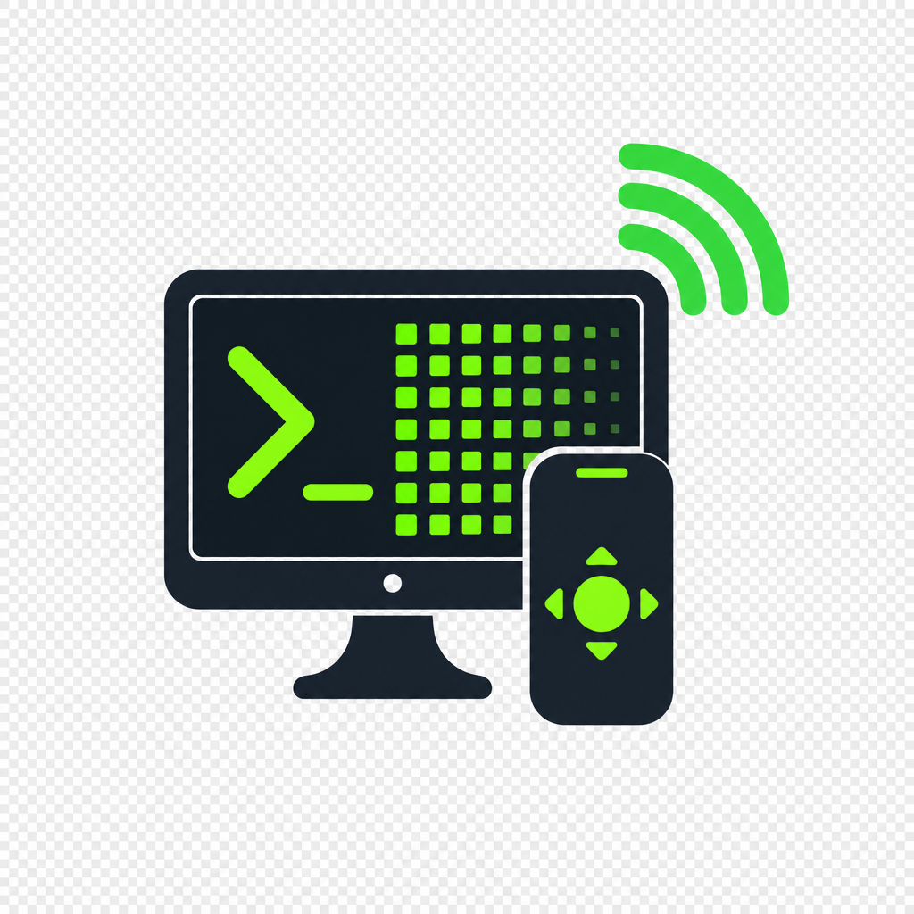
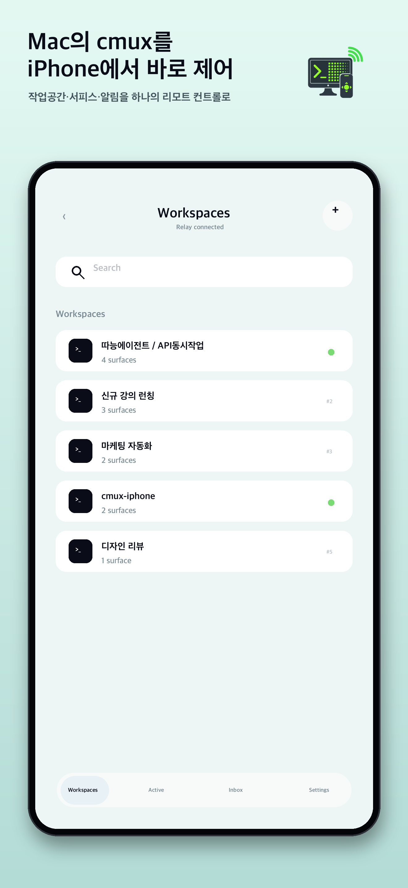
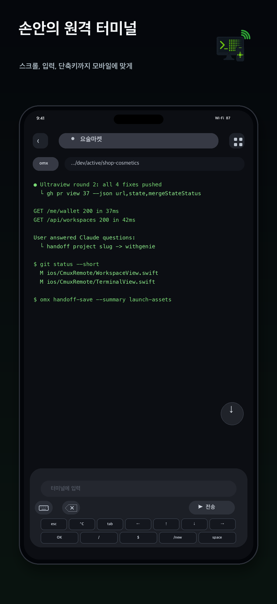
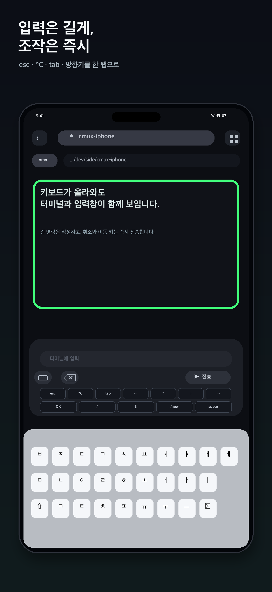
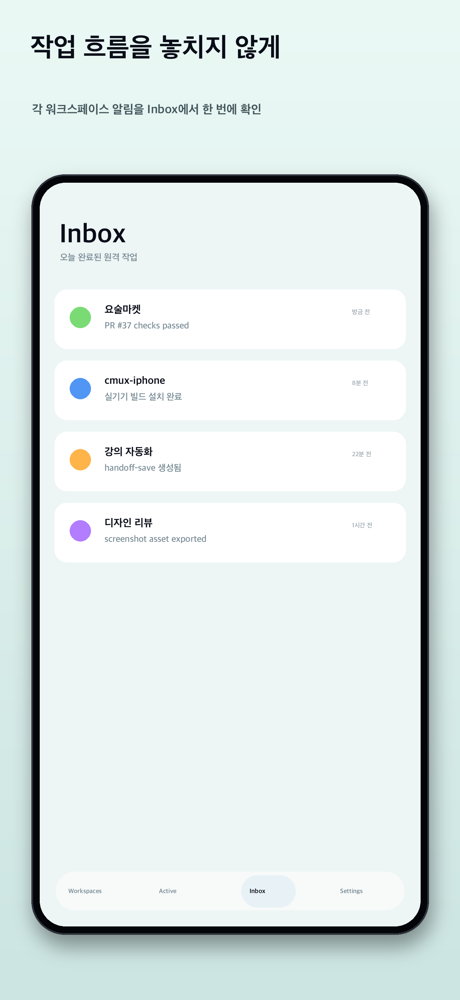
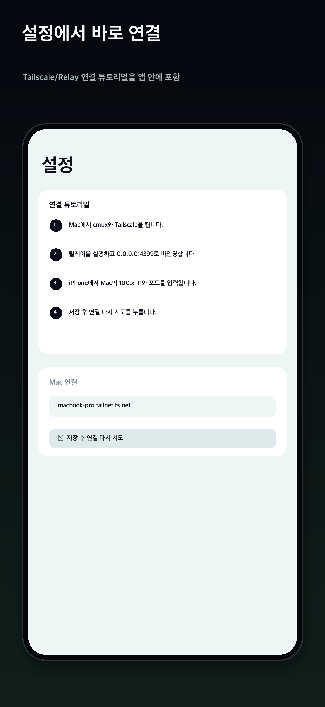

[🇰🇷 한국어](README.md) · 🇺🇸 English

# cmux Remote

> Unofficial iPhone and iPad remote for [cmux](https://github.com/manaflow-ai/cmux)
> on your Mac, over Tailscale.

cmux Remote is a SwiftUI app + Swift daemon pair that lets you read and
drive the terminals running inside cmux on your Mac from iPhone or iPad, anywhere on
your Tailscale tailnet. No port is ever exposed to the public internet
— every byte travels over your existing WireGuard mesh.

This is a community project and is **not** built or endorsed by
Manaflow. cmux Remote is an independent network client that talks to
cmux exclusively over a documented JSON-RPC protocol.

---

## What's new — v2.0.0

<p align="center">
  
</p>

New or changed since v1.1.4:

- 📝 **Markdown and text documents** — open cmux markdown tabs and text files on your phone as documents (refresh button, no live updates). Bare relative paths printed in the terminal open too.
- 🌐 **Browser tab view** — see a cmux browser tab on your phone as a screenshot, refreshed about every 2 seconds while it is on screen. Read-only: no clicks, scrolling, or navigation.
- 🤖 **AGENTS tab** — answer the questions, permission requests, and plan approvals that Claude and other agents on your Mac are waiting on (with time-left and expiry hints), and read Claude session conversations, read-only.
- 🔔 **Notification text** — notification titles and bodies show in the Inbox and in banners, and clearing notifications on your Mac clears the cards on your phone. With an `apns` block on the relay, pushes (APNs) also carry the title and body and pass through Apple's push servers ([PRIVACY.md](PRIVACY.md)).
- 📜 **Page through fullscreen terminals** — on screens with no scrollback, such as Claude Code's fullscreen view, pulling past the top or bottom edge sends Page Up / Page Down. Tabs that are not terminals open in a view that fits their kind, or an info card, instead of an empty terminal.
- 🛠️ **(relay) Reliability** — fixed repeated full-screen frames, file work that stalled the WebSocket, and images or documents over about 750 KB that failed to open or dropped the connection. Slow RPCs are logged, and `CMUX_RELAY_TRACE_RPC=1` traces every one.
- 🔄 **Relay auto-update** — the Mac relay follows only official GitHub release tags (`vX.Y.Z`) and, when a new one appears, downloads, builds, signs, and installs it by itself. It restarts only when no phone is connected (tapping [ UPDATE NOW ] in Settings applies it right away). A relay coming from 1.x needs one manual update first, and `./scripts/install-launchd.sh --no-auto-update` turns it off ([Auto-update](#auto-update)).
- 🏷️ **Version display and update notice** — the Settings version section shows the app version (`2.0.0 (22)` format) and the relay version and update state. When a newer version is on the App Store, the Settings tab shows a dot and an [ OPEN APP STORE ] button. The app checks once a day by sending Apple only the bundle ID and country ([PRIVACY.md](PRIVACY.md)).
- 🌐 **Korean/English text review** — the app follows the iOS system language (there is no in-app language picker). 49 strings that had no Korean translation are now translated, and one Korean demo string that leaked into English is fixed. Design labels such as tab names stay in English.
- 🧭 **Tab row stays visible** — tapping the command field and raising the keyboard no longer hides the surface tab row (terminal, browser, markdown) at the top of the workspace.

<table>
  <tr>
    <td align="center" width="20%"><br><sub>Workspace / surface chip bar</sub></td>
    <td align="center" width="20%"><br><sub>Live terminal mirror</sub></td>
    <td align="center" width="20%"><br><sub>Key accessory bar · Ctrl-C</sub></td>
    <td align="center" width="20%"><br><sub>Notification Inbox · push</sub></td>
    <td align="center" width="20%"><br><sub>Settings · pairing guide</sub></td>
  </tr>
</table>

> For changes in v1.1.4 and earlier, see the **Changelog** below.

---

## Status

**Early preview (v2.0.0).** It can:

- list, open, create, rename, and close cmux workspaces and surfaces
- mirror any terminal surface in near real-time (15 Hz diff polling, screen height + 240 lines of scrollback)
- send keystrokes, key combinations, raw text, command lines, and live per-character input, with a dedicated Ctrl-C shortcut
- surface cmux notifications (with title and body) in the Inbox as iOS local notifications, or
  as APNs push when the relay has an `apns` block configured
- paste iOS device clipboard text into the command composer
- attach iOS device photos by saving them to the Mac under
  `~/Downloads/cmux-remote/` and inserting the saved path
- show the connected MacBook battery state in the workspace header
- surface Claude/Codex-style `needs input` events in the Inbox
- keep the terminal input panel flush with the bottom edge and add extra scroll room so hidden terminal rows can be revealed
- pin cmux pane focus on every send
- tell surface kinds apart (terminal, browser, markdown); on screens with no scrollback, pulling past the top or bottom edge sends Page Up / Page Down
- read cmux markdown tabs and text files, and view browser tabs as screenshots (read-only)
- AGENTS tab: answer questions, permission requests, and plan approvals from Claude and other agents; read Claude conversations (read-only)
- follow official GitHub release tags with the Mac relay and update itself (restarts only when no phone is connected, can be turned off)
- show the app and relay versions and update state in Settings, and notify when a newer version is on the App Store

Smoke-tested against macOS 14 + iOS 17 on both LAN and across a Tailnet
(Tailscale 1.84+), on simulator and a physical iPhone.

> **Notification delivery** — as of 1.0.6, configuring an `apns` block on
> the relay delivers banners over APNs even when the app is killed or
> long-backgrounded. The push carries the notification's title, subtitle,
> and body, and goes from your Mac's relay through Apple's push servers to
> your device (the developer runs no server); see [PRIVACY.md](PRIVACY.md).
> Without APNs configured, notifications behave as before: local banners
> that only fire while the app is foregrounded, or while it's still alive in
> the background with an open WebSocket. (See the `apns` block under
> **Configuration**.)

---

## Changelog

> Recent changes, newest first. Format: `date · version/scope · summary`.
> Scopes — `app` (iOS app) · `relay` (Mac daemon) · `setup` (install/docs).
> Per-version App Store notes live in
> [`docs/launch-assets/release-notes/`](docs/launch-assets/release-notes/).
> Dates for 1.1.x are the App Store submission dates recorded in the release notes.

- **2026-11-09 · v2.0.0 (app + relay)** — app: markdown and text documents, browser tab view (screenshots, read-only), AGENTS tab (answer Claude questions, permissions, and plans; read Claude conversations), notification title and body in the Inbox with cards removed when you clear notifications on the Mac, Page Up / Page Down pull gesture in fullscreen terminals, surface kinds, Settings app and relay version display with [ UPDATE NOW ], App Store new-version notice (once a day, bundle ID and country only), text review (49 Korean strings), surface tab row stays visible with the keyboard up. relay: auto-update (official `vX.Y.Z` tags only, restarts only when no phone is connected, `--no-auto-update` turns it off), `relay.info` and `relay.update.start`, surface kinds and active screen, scrollback of screen height + 240 lines, document / browser / feed / Claude transcript services, notification title and body in pushes (when `apns` is configured), fixes for repeated frames, stalled file work, and large-file transfers, slow-RPC logging.
- **2026-10-27 · v1.1.4 (app)** — Option + Down Arrow shortcut. To jump to the latest output in Claude Code's fullscreen view, add `"alt+down": "scroll:bottom"` to the Scroll context in `~/.claude/keybindings.json` on your Mac.
- **2026-10-15 · v1.1.3 (app + relay)** — app: switching terminals or workspaces no longer shows the previous screen, explains why a terminal can't be opened, reconnects automatically while the relay or Tailscale is still starting, clearer connection and pairing messages. relay: pairing is bound to the Tailscale device (kept across node-key rotation) and Host/Origin checks block cross-site and DNS-rebinding requests. The relay ships from `main`, not the App Store.
- **2026-10-05 · v1.1.2 (app)** — Option + Up Arrow shortcut in the bottom row; Space label replaced with a symbol.
- **v1.1.1 (app)** — ANSI truecolor on an opaque-black viewport, long-press drag selection with one-tap copy, photo and document upload to `Downloads/cmux-remote`, recent uploads and terminal files with thumbnails and a full-screen viewer, scroll-to-bottom control moved into the command deck, Settings guidance and notification copy localized in English and Korean.
- **v1.0.9 (app)** — native tablet workspace (full window, two-row landscape deck, full-width terminal, large touch targets, all four orientations).
- **2026-07-23 · v1.0.8 (app + relay)** — app: fixed Korean/CJK wide-glyph overlap in the terminal mirror (measured font metrics + per-run clipping, geometry regression tests, #13), disabled smart punctuation in the command composer so `--` survives verbatim (#4), notification noise controls (banners only for needs-input events), release-build type-check stall fix (#11). relay: cmux 0.64+ `socket-control-password` XDG state path support (#8, #14), GUI Tailscale.app CLI PATH fallback (#14), connection-guide password fixes.
- **2026-06-23 · v1.0.6 (app + relay)** — Native APNs push notifications (banners reach a killed app when an `apns` block is configured on the relay; local-notification fallback otherwise), a dedicated Ctrl-C shortcut on the terminal keyboard bar, and all five App Store 6.9" screenshots refreshed. *Never released on the App Store — folded into v1.0.8.*
- **2026-06-06 · relay** — Track cmux's relocated socket after cmux 1.0.5 moved its Unix socket from `~/Library/Application Support/cmux` to `~/.local/state/cmux`. `cmuxSocketPath()` now follows the markers newest-convention-first (`/tmp/cmux-last-socket-path` → `~/.local/state/cmux/last-socket-path` → legacy Application Support), falling back to `~/.local/state/cmux/cmux.sock`. **No iOS app change → no App Store resubmission.**
- **2026-06-05 · v1.0.5 (app)** — LIVE per-character input mode, Korean/Hangul IME protection (no jamo splitting), bottom-flush input panel, five extra terminal scroll rows, improved `needs input` Inbox coverage.
- **2026-06-05 · setup** — Foolproof relay install script + connection guide (`docs/connection-guide.md`).
- **2026-05-29 · v1.0.4 (app)** — Cached parsed rows/style runs for faster terminal rendering, 120-line bounded history, 256-color/true-color ANSI, better checksum reconciliation.
- **2026-05-28 · v1.0.3 (relay)** — Fix repeated "Connection refused" when cmux rotates its socket, default dynamic socket discovery on reinstall, socket-path regression tests.
- **2026-05-24 · v1.0.2 (app)** — Mobile keyboard behavior, workspace create/rename/close, image attachments, connected-computer battery status, Inbox improvements.

---

## Why?

cmux is a fantastic Mac-native terminal for AI coding agents, but the
moment you walk away from your desk it goes dark. cmux Remote gives you
a thin glass pane onto the same workspaces while you're on the couch,
on a train, or debugging from a coffee shop. The Mac is still doing all
the work — the iPhone is just a remote.

---

## Architecture

```
iPhone (iOS 17+)         Tailscale            Mac
┌─────────────────────┐                       ┌────────────────────────────────┐
│ cmux Remote (app)   │── HTTP + WS ─────────▶│ cmux-relay (Swift, launchd)    │
│  · workspace list   │   (Tailscale encrypts)│  · HTTP/1.1 routes             │
│  · terminal mirror  │                       │  · /v1/stream WebSocket        │
│  · accessory bar    │◀── events.stream ─────│  · DiffEngine (15 Hz polling)  │
│  · local notifs     │                       │  · Tailscale whois auth        │
└─────────────────────┘                       │  · device tokens + rate limit  │
                                              └─────────────┬──────────────────┘
                                                            │ Unix socket
                                                            │ JSON-RPC
                                                            ▼
                                              ┌────────────────────────────────┐
                                              │ cmux.app                       │
                                              │ ~/.local/state/cmux/cmux.sock  │
                                              └────────────────────────────────┘
```

Two pieces to install:

1. **`cmux-relay`** — a small Swift daemon on the same Mac as cmux. It
   speaks JSON-RPC to cmux's local Unix socket and exposes an HTTP +
   WebSocket API on your tailnet interface. TLS is provided by the
   Tailscale WireGuard transport itself.
2. **cmux Remote (iOS)** — the SwiftUI app on your iPhone. It only
   talks to your own relay; nothing ever leaves your tailnet.

This repo deliberately ships **no** cmux source code. It is a network
client that talks to cmux over a documented JSON-RPC schema.

---

## Features

### Workspaces / surfaces

- Workspace and terminal-surface listing
- Workspace creation with the requested title sent to cmux as `workspace.create.title`
- Workspace rename (`workspace.rename`) and close (`workspace.close`) from the workspace list
- In-app surface create / close from the chip bar (with confirmation
  dialog and automatic fallback selection)
- Auto re-subscribe and bottom-pin on workspace / surface switch
- First-RPC gate (`CMUXClient.awaitReady`) so the inbound bridge is
  installed before any call goes out
- The relay carries each surface's kind (terminal, browser, markdown). Tabs that are not terminals are marked and open in a view that fits their kind (or an info card) instead of an empty terminal

### Terminal mirror

- 15 Hz diff polling, full-text fallback, checksum-based reconcile
- The relay keeps screen height + 240 lines of scrollback to avoid abrupt 24-line refreshes on surface switch / reload
- Extra five-row bottom scroll padding so rows behind the input accessory can be pulled fully into view
- Cached render rows and style runs, drawn through Canvas in run-sized batches for faster scroll and zoom
- Tokyo Night Storm palette, ANSI 256-color / true-color rendering groundwork, plus a CRT scanline shader
- Correct East-Asian wide-glyph cell width
- Suppresses iOS auto-promotion of glyphs like ● ⏺ ✔ ▶ to color emoji
  (Variation Selector-15 plus a small substitution table)
- On screens with no scrollback (the alternate screen, such as Claude Code's fullscreen view), pulling past the top or bottom edge sends one Page Up / Page Down (56 pt threshold, 0.35 s between keys in the same direction)

### Input

- Accessory bar: `esc` `OK` `/` `$` `tab` `← ↑ ↓ →` `/new` `space`
- **LIVE input mode** for immediate per-character terminal input without pressing submit
- Dedicated keyboard-dismiss, backspace, iOS device clipboard paste, and
  photo attach buttons
- Command composer with text + enter as one shot; the software keyboard
  closes automatically after submit
- Korean/Hangul IME text stays out of LIVE immediate-send mode so composed syllables do not split into jamo
- Photo attachments are saved by the Mac relay under
  `~/Downloads/cmux-remote/`, then the saved path is inserted into the
  command field
- To make the `⌥ ↓` shortcut jump Claude Code's fullscreen view to the
  bottom, add one key binding on the Mac. See the
  [connection guide FAQ](docs/connection-guide.en.md#faq).
- `surface.send_key` is delivered via an `NSEvent` synth on the Mac
  side, so multi-byte sequences (arrows, ctrl-combos) arrive
  atomically — important for Ink-based TUIs (Claude Code etc.) whose
  ESC parser fires on a lone ESC byte if the rest of the sequence is
  even a few ms behind.
- **Focus gate** — every subscribe, resubscribe, and every `sendKey`
  re-pins `surface.focus` first. iPhone keys land on the surface you
  intended even after focus moved at the Mac.

### Documents / browser

- Render cmux markdown tabs and text files on the phone as documents (refresh button, no live updates)
- The relay reads the file path from cmux — the phone sends only workspace and surface ids
- Open bare relative file paths printed in the terminal
- View cmux browser tabs as screenshots — refreshed about every 2 seconds while on screen, read-only (no clicks, scrolling, or navigation), manual refresh, pinch zoom, title and URL shown
- Large images and documents are fetched in 720 KiB chunks (relay frames stay under 1 MiB, the app accepts up to 4 MiB)

### AGENTS tab

- See and answer the questions, permission requests, and plan approvals that Claude and other agents on your Mac are waiting on (permissions: allow, always allow, deny; plans: approve, auto-accept, reject)
- Time left and an expiry notice for each open request (cmux's hook expires after about 125 seconds)
- Read Claude sessions and conversations, read-only — newest page first, scroll to the top for older pages
- The relay reads only `.jsonl` session files inside `~/.claude/projects`, and never sends file paths or resume commands to the phone

### Notifications

- Surfaces cmux `events.stream` notifications as iOS local
  notifications via `UNUserNotificationCenter`, grouped per workspace
  by `threadIdentifier`
- Authorization is requested lazily, pre-warmed once at app launch
- Duplicate-id guard — a reconnect that re-emits the same notification
  only fires one banner
- Inbox view holds the most recent 200 entries (newest first)
- Claude/Codex-style `needs input`, `needs attention`, and approval events are promoted into the same Inbox stream
- With an `apns` block configured, cmux events / `needs input` are
  delivered as APNs push (reaching a killed app); without it, the Inbox
  falls back to local notifications. The push carries the notification's
  title, subtitle, and body and passes through Apple's push servers (no
  developer server; [PRIVACY.md](PRIVACY.md))
- Deep link `cmux://surface/<id>` (payload-driven deep-link auto-open is
  planned for v1.1)
- `SEND TEST NOTIFICATION` button in Settings: a local inject for
  immediate Inbox/banner confirmation, plus a separate status line for
  the relay→cmux→events.stream round-trip
- Inbox cards show the notification title and body (the relay fills in the text cmux redacts from the event stream), every new notification raises a local banner while connected, and clearing notifications on the Mac removes the cards on the phone

### Settings screen (version / update)

- **Version section** — shows the app version (`2.0.0 (22)` format), the relay version, the update state (up to date, new version available, checking / downloading / building, ready, applying, or the failure reason), whether auto-update is on, and when it last checked. If the relay is older than 2.0, the version reads "Unknown (before 2.0)" with a hint to run `git pull` and `./scripts/install-launchd.sh`.
- **[ UPDATE NOW ]** — a button shown when the relay is 2.0 or newer and auto-update isn't turned off. After a confirmation it starts checking, downloading, and building right away, and applies the update as soon as it is ready, even with phones connected (the connection drops briefly and reconnects automatically).
- **App Store new-version notice** — when a version newer than the installed app exists, the Settings tab shows a dot and the version section shows a notice with an [ OPEN APP STORE ] button.

### Mac relay

- HTTP/1.1 with WebSocket upgrade (`SwiftNIO`)
- JSON-RPC 2.0 dispatch
- DiffEngine — actor-based, per-device FPS budget, row-granular diffs
- Auth via Tailscale UDS `whois` (foreground service) with a GUI
  fallback
- Hashed bearer tokens per device, revocable individually from the
  menu bar
- Per-device rate limiter and `boot_id`-driven reset broadcast
- Ships as a launchd user agent, with an injected `PATH` so the
  `tailscale` CLI is reachable from a stripped launchd environment
- Connected Mac battery lookup via `host.battery`, displayed as an iPhone header badge
- iPhone photo uploads saved only under `~/Downloads/cmux-remote/` via `file.upload`
- Dedicated cmux UDS channel for the events stream (the subscribed
  channel becomes push-only and won't accept further RPC responses)
- APNs push fanout (`APNsProvider`) — per-device-token delivery (title, subtitle,
  and body included), disabled when no `apns` block is configured
- Document (`surface.document.open`), browser screenshot (`surface.browser.capture`), feed reply (`feed.reply`), and Claude transcript (`claude.transcript.page`) services; file and thumbnail frames stay under 1 MiB
- Auto-update (launchd job `com.genie.cmuxremote.updater`, `relay-update.sh`) — official tags only, restarts only when no phone is connected, rolls back to the previous binary on failure ([Auto-update](#auto-update))
- `relay.info` (version, update state) and `relay.update.start` (update now) RPCs, with capability flags `relay.info.v1` and `relay.update.v1`

### Security

- Relay binds to `0.0.0.0` but refuses non-Tailscale source addresses
  at the application layer (`EndpointPolicy`)
- Per-device tokens with menu-bar revoke
- Pushes (APNs) carry the notification's title, subtitle, and body plus a
  workspace/surface id. The terminal screen itself is not sent, but the body is
  whatever text the cmux notification carries, so words written by programs
  running in your terminal can appear in it. Pushes are sent only when the
  relay has an `apns` block
- No telemetry, no analytics, and no developer-run server. Traffic that leaves
  your tailnet is limited to the following: push notifications (Mac relay →
  Apple's push servers), the App Store version check (app → Apple, bundle ID
  and country only, once a day), and the relay's GitHub tag check and download
  (Mac → GitHub, turned off with `--no-auto-update`). See
  [PRIVACY.md](PRIVACY.md)

---

## Requirements

### Mac (the relay)

- macOS 13 Ventura or newer
- A working [cmux](https://github.com/manaflow-ai/cmux) installation
  with its Unix socket exposed (default
  `~/.local/state/cmux/cmux.sock`)
- Swift 5.10 toolchain (Xcode 15.3+) to build from source
- Tailscale installed and signed in
- A free TCP port for the relay (default `4399`)

### iPhone

- iOS 17 or newer
- Same Tailnet as your Mac (Tailscale app signed in)
- Apple Developer account for sideloading (the free 7-day personal
  cert works; App Store distribution needs a paid account)

### Network

- Tailscale 1.84+ on both ends
- No Funnel, no public hostname required

---

## Quickstart

> **Can't connect?** If this is a first install, or the app says it
> can't reach your Mac, follow the step-by-step setup + troubleshooting
> guide anyone can apply →
> **[Connection guide (docs/connection-guide.en.md)](docs/connection-guide.en.md)**

### 0. Before you start (on the Mac)

The relay runs on the same Mac as cmux. Check these three things first:

```bash
cmux --version                 # cmux must be installed and running
tailscale status               # Tailscale must be signed in and online
swift --version                # Swift 5.10+ (Xcode 15.3+) to build
```

- **cmux must be running** for the relay to attach to its socket
  (otherwise you get `socketMissing`).
- Your iPhone and Mac must be signed in to the **same Tailnet**.

### 1. Build and install the relay on your Mac

```bash
git clone https://github.com/NewTurn2017/cmux-remote.git
cd cmux-remote

# Build + install as a launchd user agent (auto-starts on login).
# The script runs `swift build -c release` for you.
./scripts/install-launchd.sh
```

The installer builds the release binary and copies it into
`~/.cmuxremote/bin/`, writes a default `~/.cmuxremote/relay.json` if one
doesn't exist yet, renders
`~/Library/LaunchAgents/com.genie.cmuxremote.plist`, and bootstraps the
service. Logs land in `~/.cmuxremote/log/`.

### 2. Confirm the relay is up

```bash
# Health check — hit your own Tailscale IP from the Mac
curl -s http://$(tailscale ip -4):4399/v1/health
# {"ok":true}   ← this means the relay is healthy

# Confirm it also attached to the cmux socket
./scripts/cmux-probe.sh
# {"id":"probe-1","result":{...}}
```

The health response is open without authentication, so it carries no version. Check the relay version in the app's Settings or with `~/.cmuxremote/bin/cmux-relay --version` on the Mac.

No response or something off? Check the log first:

```bash
tail -n 40 ~/.cmuxremote/log/stderr.log
```

Seeing `starting cmux-relay on 0.0.0.0:4399` → `listening …` →
`cmux event stream attached` means it's healthy. If not, jump to
**Troubleshooting connection** below.

### 3. Pair your iPhone

First find your Mac's address:

```bash
tailscale ip -4          # e.g. 100.x.y.z  ← enter this in the app
tailscale status         # if you'd rather use the MagicDNS name (e.g. my-mac)
```

Open cmux Remote on the iPhone:

1. Tap **Add Mac**
2. Enter the Tailscale IP or MagicDNS name from above, port `4399`
3. **Add** — the relay resolves your Tailscale identity and pairs

The relay resolves its own Mac tailnet login when a phone registers, so
an iPhone on the same Tailscale account usually pairs with no extra setup.
If Tailscale is still starting, the relay returns a retryable response and
the app keeps trying automatically. Only for a different account, or when
the relay runs on a tagged node, add the login to `allow_login` under
**Configuration** below. Pairing exchanges a per-device token; revoke any
device anytime with `~/.cmuxremote/bin/cmux-relay devices revoke <id>`.

### 4. Use it

- **Workspaces** — the workspace list. Tap one to expand its surface
  chip bar, or create, rename, and close workspaces in place.
- **Terminal** — the tapped surface mirrors here. The bottom accessory
  bar carries esc / arrows / tab / mouse mode / pane toggle.
- **Notifications** — Inbox for cmux notifications. Anything delivered
  while the app is alive shows up newest-first, plus an iOS banner
  (foreground or short background only).
- **Settings** — host/port, reconnect, send test notification.

---

## Configuration

The relay reads `~/.cmuxremote/relay.json`. If the file is missing,
`install-launchd.sh` writes the default below (an existing file is
never overwritten):

```json
{
  "listen":      "0.0.0.0:4399",
  "default_fps": 15,
  "idle_fps":    5
}
```

`listen` is `0.0.0.0`, but non-Tailscale source addresses are refused
at the application layer regardless. To allow localhost in dev, run
the installer with `CMUX_DEV_ALLOW_LOCALHOST=1`.

Omitted keys fall back to the defaults above, so the three-line config
boots the relay fine. Pairing accepts logins listed in `allow_login`. It also
compares the phone login with the Mac's current Tailscale login at registration
time, so a relay that starts before Tailscale recovers without a restart.
Run the installer with `CMUX_NO_SELF_LOGIN=1` to require only explicit
`allow_login` entries; the installer persists that setting in the LaunchAgent.

Only for a different account, or a tagged-node relay, add the login by hand.
Find yours in the Tailscale admin console, or via the `User[…].LoginName`
that `Self.UserID` points to in `tailscale status --json`
(e.g. `you@example.com`). Add it and restart the relay:

```json
{
  "listen":      "0.0.0.0:4399",
  "allow_login": ["you@example.com"],
  "default_fps": 15,
  "idle_fps":    5
}
```

```bash
launchctl kickstart -k "gui/$(id -u)/com.genie.cmuxremote"
```

By default, the relay follows cmux's `last-socket-path` markers, newest
convention first: the fixed `/tmp/cmux-last-socket-path`, then
`~/.local/state/cmux/last-socket-path`, then the legacy
`~/Library/Application Support/cmux/last-socket-path`; if none resolve it falls
back to `~/.local/state/cmux/cmux.sock`. This keeps the relay from being pinned
to a stale socket when cmux rotates its socket name (e.g. `cmux-501.sock`) or an
update moves it from `~/Library/Application Support/cmux` to
`~/.local/state/cmux`. Only pass `./scripts/install-launchd.sh --socket
/path/to/socket` when you deliberately need a fixed socket. The installer
ignores an ambient `CMUX_SOCKET_PATH`, because cmux exports that variable into
every process it starts and installing from a cmux terminal would otherwise pin
the relay to whatever socket happened to be live at install time.

> **APNs push (`apns` block).** Add an `apns` block to `relay.json` and
> cmux notifications are delivered over APNs, reaching the app even when
> it's killed. The push carries the notification's title, subtitle, and body
> and passes through Apple's push servers ([PRIVACY.md](PRIVACY.md)). Without
> the block, notifications are local-only.
>
> ```json
> {
>   "apns": {
>     "key_path": "~/.cmuxremote/AuthKey_XXXXXXXXXX.p8",
>     "key_id":   "XXXXXXXXXX",
>     "team_id":  "XXXXXXXXXX",
>     "topic":    "com.genie.CmuxRemote",
>     "env":      "prod"
>   }
> }
> ```
>
> Set `env` to `"sandbox"` for dev/sideload builds, `"prod"` for App Store / release builds.

Auto-update settings are stored in `~/.cmuxremote/update/config.json`, and you change them with the installer options `--no-auto-update` and `--auto-update` ([Auto-update](#auto-update)).

---

## Operating the relay

The relay runs as a launchd user agent (`com.genie.cmuxremote`). With
`RunAtLoad` + `KeepAlive` it auto-starts on login and respawns if it dies.

```bash
SERVICE="gui/$(id -u)/com.genie.cmuxremote"

# Restart (no rebuild — the most common action)
launchctl kickstart -k "$SERVICE"

# Status (state / pid / last exit code)
launchctl print "$SERVICE" | grep -E "state|pid|last exit"

# Live logs
tail -f ~/.cmuxremote/log/stderr.log

# Pause (use bootout because KeepAlive would respawn it)
launchctl bootout "$SERVICE"
```

To pick up source changes, re-run the installer — it builds, copies,
re-renders the plist, and bootstraps + kickstarts in one shot:

```bash
./scripts/install-launchd.sh            # includes swift build -c release
./scripts/uninstall-launchd.sh          # bootout + remove plist
```

By default the relay keeps the ad-hoc signature from `swift build`. That
signature changes with every build, so macOS treats each reinstall as a new
app and asks again for access to the Downloads folder. Phone uploads and
terminal attachments live there. Until someone clicks Allow on the Mac, those
requests answer `temporarily_unavailable` after about 4 seconds. The screen
and typing are not blocked, though input can arrive a few seconds late right
after you open a terminal. If you have a signing identity, pass it once.
The installer remembers it in `~/.cmuxremote/codesign-identity`:

```bash
security find-identity -v -p codesigning     # list identities
./scripts/install-launchd.sh --sign "Developer ID Application: Your Name (TEAMID)"
./scripts/install-launchd.sh --sign adhoc    # back to ad-hoc
```

The first install with the new identity asks for Downloads access once.
Later reinstalls keep it.

### Auto-update

Starting with 2.0.0 the relay updates itself by following **only official release tags (`vX.Y.Z`)** of the GitHub repository `https://github.com/NewTurn2017/cmux-remote`. It never looks at the `main` branch or arbitrary commits, and it ignores suffixed tags such as `-rc`. If you run a development branch build, install with `./scripts/install-launchd.sh --no-auto-update`, because a new tag would overwrite it.

- **Who does it** — a launchd job that runs separately from the relay, `com.genie.cmuxremote.updater` (`~/.cmuxremote/libexec/relay-update.sh`), wakes every 5 minutes and checks whether a check is due. It never touches the checkout you installed from; it downloads and builds only in a managed clone at `~/.cmuxremote/src/cmux-remote`.
- **When it checks** — the first check comes about 15 to 20 minutes after installation, then at most once an hour. If there is a `vX.Y.Z` tag newer than the installed version and its commit is part of `origin/main`, it downloads, builds, signs, and installs it.
- **When it restarts** — only after no phone has been connected for 2 minutes (120 seconds). [ UPDATE NOW ] in the app applies the update at once, even with phones connected (the connection drops briefly while the relay restarts and reconnects automatically).
- **If it fails** — if the new relay isn't up as the new version within 60 seconds and still alive 15 seconds later, the previous relay is restored and that tag is not retried automatically. A tag whose build failed is not rebuilt automatically either (it is retried when the toolchain changes or when you ask).
- **Signing** — it signs with the remembered `~/.cmuxremote/codesign-identity`. If signing fails it does not fall back to ad-hoc; it records the failure and lengthens the retry interval. Without an identity the build is ad-hoc signed, and macOS may ask again for Downloads access after an update (Settings and `update.log` carry a warning).
- **Checking status** — the version section in the app's Settings, or `tail ~/.cmuxremote/log/update.log` on the Mac. If something is wrong, also look at `~/.cmuxremote/update/last-git.log` and `~/.cmuxremote/log/updater.stderr.log`. Logs hold only tags, commits, states, and times, and shorten home paths to `~`.
- **What it needs** — `git` and a Swift toolchain on the Mac. The managed clone and build cache use disk (about 0.8 GB, an estimate and not a measurement), and no update starts when less than 2 GiB is free before the build.
- **Dependency versions** — `Package.resolved` is not tracked in the repository, so an update fetches the newest compatible SwiftPM dependencies and builds can differ between users. If a new dependency version breaks the build, that tag is remembered as `build_failed` and is not installed.
- **Following another repository** — `./scripts/install-launchd.sh --update-origin <https git URL>` (the default is the GitHub repository above).

**Turning it off and on** — `./scripts/install-launchd.sh --no-auto-update` turns it off by not installing (or by removing) the updater job, and the choice is remembered. While it is off, the relay makes no GitHub request at all, and the app's Settings says auto-update is turned off on the Mac. Run `./scripts/install-launchd.sh --auto-update` to turn it back on.

**Moving up from 1.x the first time** — a 1.x relay has no updater, so update it by hand once. Run `git pull` in the repository to get 2.0.0 or newer, then `./scripts/install-launchd.sh` (your signing identity is remembered). That installs relay 2.0.0 and the updater together, and updates are automatic from then on. If the app's Settings shows the relay version as "Unknown (before 2.0)", it is still a 1.x relay.

**Uninstalling** — `./scripts/uninstall-launchd.sh` removes the relay and updater jobs and plists, the updater script in `~/.cmuxremote/libexec`, the `update/` state, and the managed clone. Add `--keep-update-cache` to keep the clone (the build cache). `relay.json`, `devices.json`, `codesign-identity`, and `bin/` stay.

---

## Troubleshooting connection

If the iPhone app can't connect, run these checks **on the Mac**, in
order — one line at a time. Most issues are resolved by step ① or ②. For
a full step-by-step walkthrough and a notice you can hand to users, see
the **[connection guide](docs/connection-guide.en.md)**.

```bash
SERVICE="gui/$(id -u)/com.genie.cmuxremote"
```

| Check | Command | If it fails |
|---|---|---|
| ① Is cmux running? | `cmux --version` | Launch the cmux app, then `launchctl kickstart -k "$SERVICE"` |
| ② Is the relay up? | `curl -s http://$(tailscale ip -4):4399/v1/health` | `launchctl kickstart -k "$SERVICE"`; if still down, re-run `./scripts/install-launchd.sh` |
| ③ Logs healthy? | `tail -n 40 ~/.cmuxremote/log/stderr.log` | See the per-log fixes below |
| ④ Tailscale online both ends? | `tailscale status` | Make sure Mac and iPhone are on the same Tailnet |
| ⑤ Right address in the app? | `tailscale ip -4` | Confirm the app uses this IP + port `4399` |

Per-log fixes:

- `cmux event stream unavailable: socketMissing` — **cmux is not
  running.** Launch the cmux app, then `launchctl kickstart -k "$SERVICE"`.
- Repeated `Connection refused` — **the socket path changed** (cmux rotated
  its socket name, or an update moved it to `~/.local/state/cmux`). A current
  relay tracks the markers automatically, so re-running
  `./scripts/install-launchd.sh` fixes it. In a pinch, pin the path from
  the current marker with
  `./scripts/install-launchd.sh --socket "$(cat /tmp/cmux-last-socket-path)"`.
- Health check OK but the app shows **waiting for relay**: the relay can
  reach the phone but the Mac Tailscale identity is still starting. The app
  retries automatically. Check `tailscale status` if it persists.
- The app says **Pairing was removed on the Mac**: the saved bearer was
  revoked or removed. Select **Unpair This Device**, then reconnect to pair
  through Tailscale again.
- `registration denied` in the relay log: the phone's Tailscale login is
  outside the Mac login and `allow_login` policy. Add the intended login to
  `relay.json`, then send `SIGHUP` or restart the relay.
- Health check OK but the app cannot reach the relay: confirm the iPhone and
  Mac share a tailnet and the app uses the current IP plus port `4399`.

The startup log should print `starting cmux-relay on 0.0.0.0:4399` →
`listening …` → `cmux event stream attached`. If you restart cmux often,
the fastest way to re-attach after a socket rotation is
`launchctl kickstart -k "$SERVICE"`.

---

## Roadmap

- [x] v1.0 — workspace listing, surface create/close, terminal mirror,
      keystroke send, mouse mode, pane toggle, local notifications,
      Tokyo Night Storm UI
- [x] v1.0.2 — keyboard layout fixes, photo attach, MacBook battery badge,
      `needs input` Inbox handling, workspace create/rename/close
- [x] v1.0.3 — real-device relay socket rotation / reconnection reliability
- [x] v1.0.4 — terminal rendering performance, 120-line history, ANSI 256-color / true-color groundwork, physical iPhone live-relay smoke validation
- [x] v1.0.5 — LIVE input mode, Hangul IME guard, bottom-flush input panel, five-row terminal scroll padding, Claude/Codex Inbox regression coverage
- [x] v1.0.6 — native APNs push (reaches a killed app), Ctrl-C shortcut, all five App Store screenshots refreshed (never released — folded into 1.0.8)
- [x] v1.0.8 — Korean/CJK overlap rendering fix, `--` smart-punctuation input protection, notification noise controls, cmux 0.64+ setup compatibility (relay)
- [x] v2.0.0 — surface kinds and fullscreen Page Up / Page Down, markdown / text document and browser tab viewing, AGENTS tab (feed replies, Claude conversations), notification text, relay auto-update, Settings app and relay version display with an App Store new-version notice, text review, tab row stays visible with the keyboard up, relay reliability fixes
- [ ] **v1.1 — push follow-ups** — payload-driven deep-link auto-open to the surface, delivery reliability / retries
- [x] Native iPad landscape layout
- [ ] v1.2 — External keyboard polish
- [ ] v1.3 — file preview for cmux's "open in pane" intents
- [ ] v2.x and later — byte-stream RPC for high-rate TUIs (vim, htop, k9s)
- [ ] Maybe — Android client (PRs welcome, see `docs/specs/`)

Explicit non-goals: public-internet exposure (Tailscale Funnel),
multi-user sharing, server-side persistence beyond the live session.

---

## Project layout

```
cmux-remote/
├─ README.md / README.en.md
├─ LICENSE
├─ docs/
│  ├─ screenshots/          # README assets
│  └─ specs/                # design docs, RFCs
├─ Package.swift            # SharedKit / CMUXClient / RelayCore / cmux-relay
├─ Sources/
│  ├─ SharedKit/            # Codable models, JSON-RPC envelope, key tables, screen hasher
│  ├─ CMUXClient/           # cmux UDS JSON-RPC client (Mac only)
│  ├─ RelayCore/            # Auth, sessions, DiffEngine, RowState, DeviceStore
│  └─ RelayServer/          # @main, NIO HTTP+WS, launchd entry point
├─ Tests/                   # unit + integration tests
├─ ios/
│  ├─ CmuxRemote.xcodeproj
│  └─ CmuxRemote/
│     ├─ CmuxRemoteApp.swift / ContentView.swift
│     ├─ Network/           # RPCClient, WSClient, AuthClient, EndpointPolicy
│     ├─ Notifications/     # LocalNotificationPresenter, NotificationCenterView
│     ├─ Stores/            # WorkspaceStore, SurfaceStore, NotificationStore, HostStatusStore
│     ├─ Terminal/          # CellGrid, ANSIParser, TerminalView, cell-width
│     ├─ Workspace/         # WorkspaceListView, WorkspaceDrawer, WorkspaceView
│     ├─ Settings/          # SettingsView
│     ├─ Keyboard/          # CommandComposer
│     ├─ UI/                # Tokyo Night theme, splash, Metal shader
│     ├─ Security/          # HardeningCheck
│     └─ Storage/           # Keychain
└─ scripts/
   ├─ install-launchd.sh    # cmux-relay launchd installer
   ├─ uninstall-launchd.sh
   ├─ relay.plist.tmpl
   ├─ cmux-probe.sh         # ping the cmux socket
   ├─ smoke-relay.sh        # end-to-end tailnet smoke
   └─ evaluate-terminal-keyboard.sh
```

> Internal identifiers use the camelCased `CmuxRemote` (Xcode target,
> Swift module names, bundle ID `com.genie.CmuxRemote`). The
> home-screen display name is **cmux Remote** with a space. Both are
> correct.

---

## Development

```bash
# Run all Swift tests (relay + shared kits)
swift test

# Generate the Xcode project for the iOS app
cd ios && xcodegen generate

# Run the iOS test suite against a fake in-process relay
xcodebuild test -project CmuxRemote.xcodeproj \
  -scheme CmuxRemote -destination 'platform=iOS Simulator,name=iPhone 15'

# Full smoke against a real cmux + real Tailscale (slow; ephemeral node)
SMOKE_EPHEMERAL=1 ./scripts/smoke-relay.sh
```

The smoke script uses isolated relay state, registers the live Tailscale
caller, and exercises every documented relay endpoint (`/v1/health`,
`/v1/devices/me/register`, `/v1/devices/me`, `/v1/state`,
`/v1/devices/me/apns`, and the WebSocket upgrade). It carries the existing
cmux socket password into the isolated process without writing that secret to
the test directory. The readiness phase has one 15-second deadline.

The iOS app uses `FakeRPCDispatch` (default in DEBUG simulator builds,
or `FAKE_RPC=1`), so the project builds, runs, and passes UI tests
without a real relay attached.

---

## Contributing

Issues and PRs are welcome. A few ground rules:

- One feature per PR. Keep the diff small.
- Add or update tests. The relay has decent unit coverage; the iOS app
  has a fake-relay dispatch for UI tests. Don't regress either.
- Don't paste cmux source code into this repo. We deliberately keep
  this side license-clean (see below).
- Bug reports should include relay log lines and the cmux version
  (`cmux --version`).

For larger ideas (new transport, new auth model, byte-stream RPC),
open a discussion or drop a design doc under `docs/specs/` first.

---

## Security

- The relay binds to the tailnet interface only — non-Tailscale source
  addresses are refused at the application layer (the only escape
  hatch is `CMUX_DEV_ALLOW_LOCALHOST=1` for dev).
- Every bearer is bound to the Tailscale node key that registered it.
  Authenticated HTTP and WebSocket requests re-check the live caller identity.
- Per-device tokens can be revoked individually from the relay CLI.
- Registration and caller identity lookups are coalesced and briefly cached,
  including unavailable results, to bound local Tailscale process load.
- Pushes (APNs) carry the notification's title, subtitle, and body plus a
  workspace/surface id. The terminal screen itself is not sent, but the body is
  whatever text the cmux notification carries, so words written by programs
  running in your terminal can appear in it. Pushes are sent only when the
  relay has an `apns` block, and go from your Mac's relay through Apple's push
  servers to your device.
- No telemetry. No analytics. No developer-run server. Traffic that leaves your
  tailnet is limited to the following: push notifications (Mac relay → Apple's
  push servers), the App Store version check (app → Apple, bundle ID and
  country only, once a day), and the relay's GitHub tag check and download
  (Mac → GitHub, turned off with `--no-auto-update`). See
  [PRIVACY.md](PRIVACY.md).

If you find a security issue, please email the maintainer (see
`SECURITY.md`) instead of filing a public issue.

---

## License

cmux Remote is released under the **MIT License** — see
[`LICENSE`](LICENSE).

### Relationship to cmux

[cmux](https://github.com/manaflow-ai/cmux) is © Manaflow, Inc. and is
dual-licensed under GPL-3.0-or-later or a commercial license. cmux
Remote is an **independent network client**. It does not include, link
to, or modify any cmux source code; it communicates with cmux
exclusively over a documented JSON-RPC protocol. The Free Software
Foundation's general position is that a program that interacts with a
GPL program purely over a documented network protocol is not a
derivative work of that program, and cmux Remote is distributed on
that basis.

### Trademark notice

"cmux" is a name used by Manaflow, Inc. to identify their terminal
product. cmux Remote uses the name "cmux" only descriptively, to
identify the software this client is designed to interoperate with.
cmux Remote is not affiliated with, sponsored by, or endorsed by
Manaflow, Inc. If you're from Manaflow and would like the name
changed, please open an issue — we'll rename without argument.

---

## Acknowledgements

- The [cmux](https://github.com/manaflow-ai/cmux) team for building
  the terminal this app extends.
- [Tailscale](https://tailscale.com) for the boring-but-perfect
  transport.
- [SwiftNIO](https://github.com/apple/swift-nio) for the relay's
  HTTP/WS stack.
