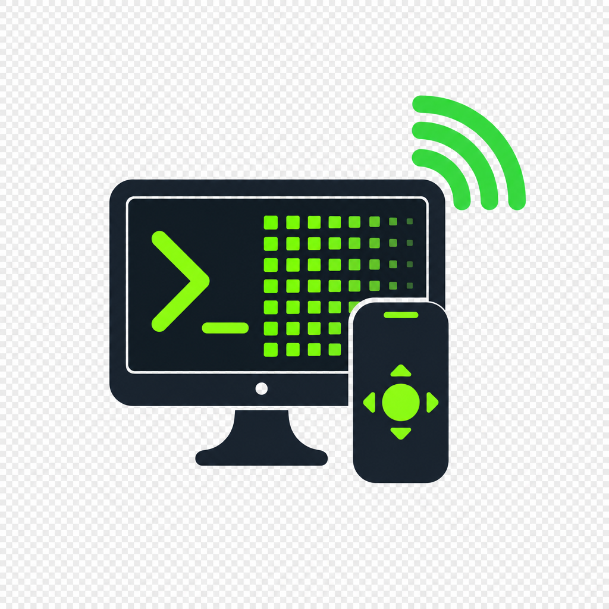
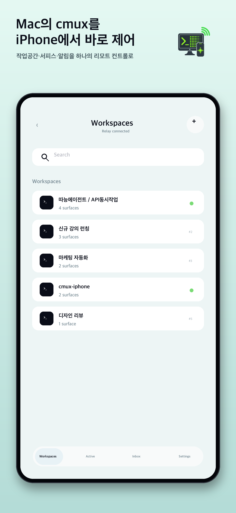
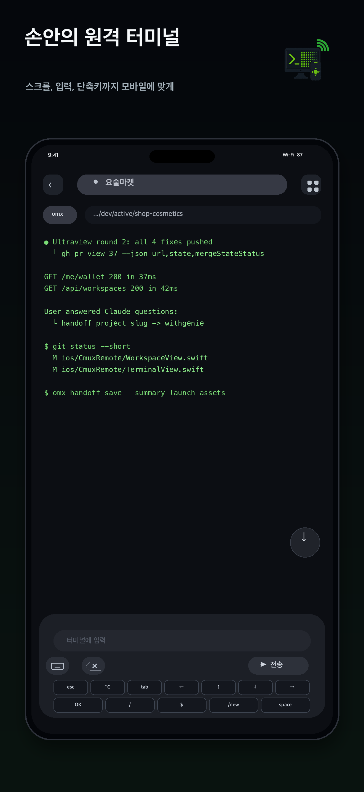
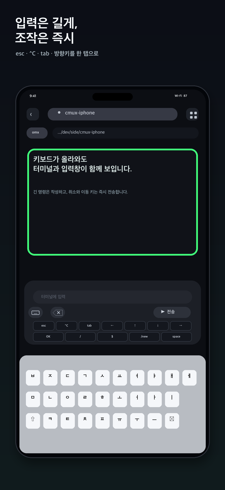
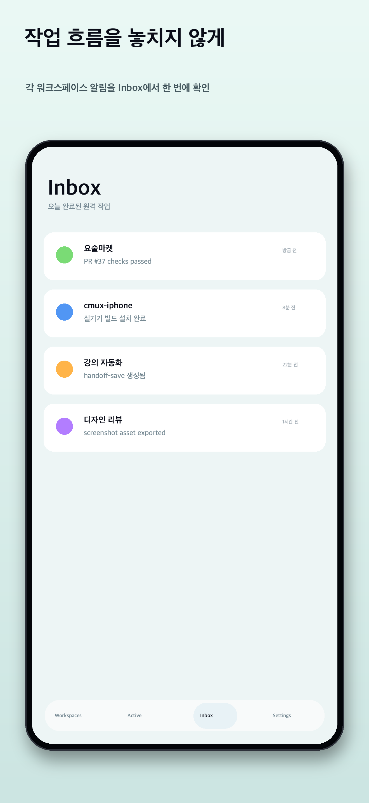
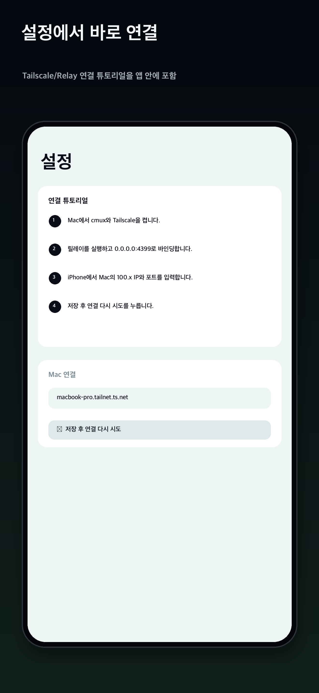

🇰🇷 한국어 · [🇺🇸 English](README.en.md)

# cmux Remote

> Tailscale 네트워크 너머에서 [cmux](https://github.com/manaflow-ai/cmux)
> 터미널을 iPhone과 iPad로 조작하는 비공식 원격 클라이언트.

cmux Remote는 Mac에서 돌아가는 cmux의 작업공간과 터미널을 iPhone과 iPad에서
읽고 조작할 수 있게 해주는 SwiftUI 앱 + Swift 데몬 묶음입니다. 모든
트래픽은 사용자의 Tailscale tailnet 안에서만 흐르며, 공용 인터넷으로
노출되는 포트는 없습니다.

이 프로젝트는 **Manaflow가 만들거나 공식 지원하는 결과물이 아닙니다.**
cmux와 문서화된 JSON-RPC 프로토콜로만 통신하는 독립 네트워크 클라이언트.

---

## 이번 업데이트 — v2.0.0

<p align="center">
  
</p>

v1.1.4 이후 새로 추가되거나 바뀐 점:

- 📝 **마크다운·텍스트 문서 보기** — cmux 마크다운 탭과 텍스트 파일을 폰에서 문서로 읽습니다(새로고침 버튼, 실시간 갱신 없음). 터미널에 찍힌 상대 경로 파일도 열 수 있습니다.
- 🌐 **브라우저 탭 보기** — cmux 브라우저 탭을 폰에서 스크린샷으로 봅니다. 화면에 보이는 동안 약 2초마다 갱신되며 읽기 전용입니다(클릭·스크롤·이동 없음).
- 🤖 **AGENTS 탭** — Mac에서 Claude 등이 기다리는 질문·권한 요청·플랜 승인에 폰으로 답하고(남은 시간·만료 표시), Claude 세션 대화를 읽기 전용으로 봅니다.
- 🔔 **알림 본문** — 알림 제목·본문이 Inbox와 배너에 표시되고, Mac에서 알림을 지우면 폰 카드도 사라집니다. relay에 `apns` 블록이 있으면 푸시(APNs)에도 제목·본문이 들어가며 Apple 푸시 서버를 거칩니다([PRIVACY.md](PRIVACY.md)).
- 📜 **전체 화면 터미널 페이지 넘김** — Claude Code 전체 화면처럼 스크롤 기록이 없는 화면에서 맨 위·아래를 넘겨 당기면 Page Up·Page Down이 전송됩니다. 터미널이 아닌 탭은 빈 터미널 대신 종류에 맞는 화면이나 안내 카드로 열립니다.
- 🛠️ **(relay) 안정성** — 같은 화면이 반복 전송되던 문제, 파일 작업이 WebSocket을 막던 문제, 큰 이미지·문서(약 750 KB 초과)가 열리지 않거나 연결이 끊기던 문제를 고쳤습니다. 느린 RPC는 로그에 남고 `CMUX_RELAY_TRACE_RPC=1`로 전부 추적할 수 있습니다.
- 🔄 **relay 자동 업데이트** — Mac relay가 GitHub의 정식 릴리스 태그(`vX.Y.Z`)만 따라가며, 새 태그가 나오면 스스로 받아 빌드·서명·설치합니다. 재시작은 폰이 하나도 연결돼 있지 않을 때만 합니다(설정의 [ UPDATE NOW ]로 직접 요청하면 바로 적용). 1.x에서 올라올 때는 처음 한 번만 수동 업데이트가 필요하고, 끄려면 `./scripts/install-launchd.sh --no-auto-update`입니다([자동 업데이트](#자동-업데이트)).
- 🏷️ **버전 표시와 업데이트 안내** — 설정의 version 섹션에 앱 버전(`2.0.0 (22)` 형식)과 relay 버전·업데이트 상태가 보입니다. App Store에 새 버전이 있으면 설정 탭에 점이 뜨고 [ OPEN APP STORE ] 버튼으로 안내합니다. 앱은 하루 한 번 Apple에 번들 ID와 국가만 보내 최신 버전을 확인합니다([PRIVACY.md](PRIVACY.md)).
- 🌐 **한글/영어 번역 점검** — 앱은 iOS 시스템 언어를 그대로 따릅니다(앱 안 언어 선택은 없음). 한국어 화면에서 번역이 빠져 있던 문구 49개를 번역하고, 영어 화면에 새던 한국어 데모 문구 1개를 고쳤습니다. 탭 이름 같은 디자인 라벨은 영어로 유지합니다.
- 🧭 **탭 줄 유지** — 워크스페이스 화면에서 입력창을 눌러 키보드가 떠도 상단 surface 탭 줄(터미널·브라우저·마크다운)이 사라지지 않습니다.

<table>
  <tr>
    <td align="center" width="20%"><br><sub>작업공간 / surface 칩바</sub></td>
    <td align="center" width="20%"><br><sub>터미널 실시간 미러링</sub></td>
    <td align="center" width="20%"><br><sub>키 액세서리 바 · Ctrl-C</sub></td>
    <td align="center" width="20%"><br><sub>알림 Inbox · 푸시</sub></td>
    <td align="center" width="20%"><br><sub>설정 · 페어링 가이드</sub></td>
  </tr>
</table>

> v1.1.4 이하 변경 내역은 아래 **변경 이력** 참고.

---

## 상태

**얼리 프리뷰 (v2.0.0).** 다음이 됩니다:

- cmux 작업공간 / surface 목록 보기, 생성, 이름 변경, 닫기
- 임의의 터미널 surface를 실시간 미러링 (15Hz diff 폴링, 화면 높이 + 240줄 스크롤백)
- 키 입력 / 키 조합 / 텍스트 / 커맨드 라인 / LIVE 즉시 입력 전송 · Ctrl-C 단축키
- iOS 기기 클립보드 붙여넣기 + 사진 첨부 경로 삽입
- 연결된 MacBook 배터리 상태 표시
- cmux 알림(제목·본문 포함)과 Claude/Codex 계열 `needs input` 이벤트를 iOS Inbox + 로컬 알림 또는 APNs 푸시로 표시
- 입력 패널을 화면 하단에 붙이고, 가려진 터미널 줄을 끌어올릴 수 있도록 하단 스크롤 여유 추가
- 마우스 모드 TUI 탭 입력 (Textual / Bubble Tea / fzf / omx 등)
- pane 포커스 자동 고정 + 이전 pane 토글
- surface 종류(터미널·브라우저·마크다운) 구분, 스크롤 기록 없는 전체 화면 터미널은 맨 위·아래를 넘겨 당겨 Page Up·Page Down
- cmux 마크다운 탭·텍스트 파일 문서 보기, 브라우저 탭 스크린샷 보기(읽기 전용)
- AGENTS 탭: Claude 등의 질문·권한·플랜 승인에 답하기, Claude 대화 기록 읽기(읽기 전용)
- Mac relay가 GitHub 정식 릴리스 태그를 따라 스스로 업데이트 (폰이 연결돼 있지 않을 때만 재시작, 끌 수 있음)
- 설정 화면에 앱·relay 버전과 업데이트 상태 표시, App Store에 새 버전이 있으면 안내

macOS 14 + iOS 17 실기기 + 시뮬레이터에서 같은 Wi-Fi와 Tailnet
환경에서 스모크 테스트했습니다 (Tailscale 1.84+).

> **알림 전달** — 1.0.6부터 relay에 `apns` 블록을 설정하면 앱이 종료/장시간
> 백그라운드 상태여도 APNs 푸시로 배너가 도착합니다. 푸시에는 알림의
> 제목·부제·본문이 들어가며 Mac relay에서 Apple 푸시 서버를 거쳐 기기로
> 갑니다(개발자 서버는 없습니다). 자세한 내용은 [PRIVACY.md](PRIVACY.md)를
> 보세요. APNs를 설정하지 않으면 기존처럼 앱이 foreground이거나
> 백그라운드에서 WebSocket이 살아있는 동안만 뜨는 로컬 알림으로 동작합니다.
> (아래 **설정**의 `apns` 블록 참고.)

---

## 변경 이력

> 최근 변경을 최신순으로 요약합니다. 형식: `날짜 · 버전/범위 · 요약`.
> 범위 — `app`(iOS 앱) · `relay`(Mac 데몬) · `setup`(설치/문서).
> 버전별 App Store 상세 노트는
> [`docs/launch-assets/release-notes/`](docs/launch-assets/release-notes/)에 있습니다.
> 1.1.x의 날짜는 릴리스 노트에 기록된 App Store 제출일입니다.

- **2026-11-09 · v2.0.0 (app + relay)** — app: 마크다운·텍스트 문서와 브라우저 탭(스크린샷, 읽기 전용) 보기, AGENTS 탭(Claude 질문·권한·플랜 응답, Claude 대화 기록 읽기), 알림 제목·본문 표시와 Mac에서 지우면 폰 카드 삭제, 전체 화면 터미널 Page Up/Down 제스처, surface 종류 구분, 설정의 앱·relay 버전 표시와 [ UPDATE NOW ], App Store 새 버전 안내(하루 한 번 번들 ID·국가만 조회), 번역 점검(한국어 49문구), 키보드가 떠도 surface 탭 줄 유지. relay: 자동 업데이트(정식 태그 `vX.Y.Z`만, 폰이 연결돼 있지 않을 때만 재시작, `--no-auto-update`로 끔), `relay.info`·`relay.update.start`, surface 종류·활성 화면 전달, 스크롤백 화면 높이 + 240줄, 문서·브라우저·feed·Claude 대화 기록 서비스, 푸시에 알림 제목·본문 포함(`apns` 설정 시), 반복 프레임·파일 작업 정체·큰 파일 전송 수정, 느린 RPC 로그.
- **2026-10-27 · v1.1.4 (app)** — Option + 아래쪽 방향키 단축키 추가. Claude Code 전체 화면에서 최신 출력으로 내려가려면 Mac의 `~/.claude/keybindings.json` Scroll 컨텍스트에 `"alt+down": "scroll:bottom"`을 추가해야 합니다.
- **2026-10-15 · v1.1.3 (app + relay)** — app: 터미널·워크스페이스 전환 때 이전 화면이 남지 않게 수정, 열 수 없는 터미널은 이유 안내, relay·Tailscale이 시작 중이면 자동 재연결과 연결·페어링 메시지 개선. relay: 페어링을 Tailscale 기기에 묶고(노드 키 교체 때도 유지) Host/Origin 검증으로 교차 사이트·DNS 리바인딩 요청 차단. relay는 App Store가 아니라 `main`에서 배포됩니다.
- **2026-10-05 · v1.1.2 (app)** — Option + 위쪽 방향키 단축키 추가(맨 아래 줄), Space 라벨을 기호로 교체.
- **v1.1.1 (app)** — ANSI 트루컬러(불투명 검은 viewport), 길게 눌러 드래그 선택·한 번에 복사, 사진·문서 업로드(`Downloads/cmux-remote`), 최근 업로드·터미널 파일 썸네일과 전체 화면 뷰어, 맨 아래 이동 버튼 위치 변경, Settings 안내·알림 문구 한/영 현지화.
- **v1.0.9 (app)** — 태블릿 네이티브 작업공간(전체 창, 가로 화면 2단 패널, 전체 너비 터미널, 큰 터치 영역, 네 방향 지원).
- **2026-07-23 · v1.0.8 (app + relay)** — app: 한글/CJK wide glyph 겹침 렌더링 수정(실측 폰트 메트릭 + run 클리핑, 기하 회귀 테스트, #13), 커맨드 입력 스마트 구두점 비활성화(`--` → em dash 방지, #4), 알림 소음 컨트롤(입력 필요 이벤트만 배너), release 빌드 타입체크 스톨 해소(#11). relay: cmux 0.64+ `socket-control-password` XDG state 경로 지원(#8, #14), GUI Tailscale.app CLI PATH 폴백(#14), 연결 가이드 password 안내 교정.
- **2026-06-23 · v1.0.6 (app + relay)** — 네이티브 APNs 푸시 알림(relay `apns` 블록 설정 시 앱 종료 상태에도 배너 도착, 미설정 시 로컬 알림 폴백), 터미널 키보드 바 Ctrl-C 단축키, App Store 6.9" 스크린샷 5장 전체 교체. *App Store에는 미공개 — v1.0.8에 통합 출시.*
- **2026-06-06 · relay** — cmux 1.0.5가 Unix 소켓을 `~/Library/Application Support/cmux`에서 `~/.local/state/cmux`로 이전한 것에 대응. `cmuxSocketPath()`가 마커를 최신순(`/tmp/cmux-last-socket-path` → `~/.local/state/cmux/last-socket-path` → 레거시 Application Support)으로 추적하고, 없으면 `~/.local/state/cmux/cmux.sock`로 폴백. **iOS 앱 무변경 → App Store 재제출 불필요.**
- **2026-06-05 · v1.0.5 (app)** — LIVE 즉시 입력 모드(문자 단위 즉시 전송), 한글 IME 보호(조합 중 자모 분리 방지), 입력 패널 하단 flush, 터미널 하단 스크롤 여유 5줄, `needs input` Inbox 커버리지 개선.
- **2026-06-05 · setup** — relay 설치 스크립트 foolproof화 + 연결 가이드(`docs/connection-guide.md`) 추가.
- **2026-05-29 · v1.0.4 (app)** — 파싱 row/style run 캐싱으로 터미널 렌더링 가속, 120줄 bounded history, 256색/트루컬러 ANSI, checksum 정합 개선.
- **2026-05-28 · v1.0.3 (relay)** — cmux가 소켓을 rotation할 때 stale 소켓을 붙잡아 "Connection refused"가 반복되던 문제 수정, 재설치 시 기본 동적 소켓 탐색, 소켓 경로 회귀 테스트 추가.
- **2026-05-24 · v1.0.2 (app)** — 모바일 키보드 동작 개선, 작업공간 생성/이름변경/닫기, 이미지 첨부, 연결 컴퓨터 배터리 상태, Inbox 개선.

---

## 왜?

cmux는 AI 코딩 에이전트를 굴리기에 훌륭한 Mac 네이티브 터미널이지만,
책상을 떠나는 순간 모든 진행이 화면 너머로 사라집니다. cmux Remote는
같은 작업공간에 얇은 유리창을 하나 더 붙여서, 소파에서, 지하철에서,
카페에서도 Mac이 하고 있는 일을 확인하고 키 입력으로 끼어들 수 있게
합니다. 일은 여전히 Mac이 다 하고, iPhone은 그저 원격 조종기.

---

## 아키텍처

```
iPhone (iOS 17+)         Tailscale            Mac
┌─────────────────────┐                       ┌────────────────────────────────┐
│ cmux Remote (앱)    │── HTTP + WS ─────────▶│ cmux-relay (Swift, launchd)    │
│  · 작업공간 목록    │   (Tailscale가 암호화)│  · HTTP/1.1 라우트             │
│  · 터미널 미러      │                       │  · /v1/stream WebSocket        │
│  · 액세서리 키바    │◀── events.stream ─────│  · DiffEngine (15Hz 폴링)      │
│  · 로컬 알림        │                       │  · Tailscale whois 인증        │
└─────────────────────┘                       │  · 디바이스 토큰 + Rate Limit  │
                                              └─────────────┬──────────────────┘
                                                            │ Unix socket
                                                            │ JSON-RPC
                                                            ▼
                                              ┌────────────────────────────────┐
                                              │ cmux.app                       │
                                              │ ~/.local/state/cmux/cmux.sock  │
                                              └────────────────────────────────┘
```

설치는 두 파트:

1. **`cmux-relay`** — cmux와 같은 Mac에서 도는 Swift 데몬. cmux의 로컬
   Unix 소켓에 JSON-RPC로 붙고, tailnet 인터페이스에 HTTP+WebSocket을
   띄웁니다. TLS는 Tailscale의 WireGuard 전송이 담당.
2. **cmux Remote (iOS)** — SwiftUI 앱. 사용자 본인의 relay에만 붙고,
   외부 네트워크로 나가는 호출은 없습니다.

cmux 소스 코드는 이 저장소에 포함되지 않습니다. 문서화된 JSON-RPC
스키마로만 cmux와 통신합니다.

---

## 기능

### 작업공간 / surface

- 작업공간 / 터미널 surface 목록
- 워크스페이스 생성 시 입력한 제목을 cmux `workspace.create`의 `title`로 반영
- 워크스페이스 이름 변경 (`workspace.rename`) / 닫기 (`workspace.close`)
- 칩바에서 surface 생성 / 닫기 (확정 다이얼로그 포함)
- 작업공간 전환 / surface 전환 시 자동 재구독 + 하단 자동 스크롤
- 첫 RPC 게이트 (`CMUXClient.awaitReady`) — inbound bridge 설치 race 방지
- surface 종류(터미널·브라우저·마크다운)를 relay가 전달합니다. 터미널이 아닌 탭은 표시가 붙고, 빈 터미널 대신 종류에 맞는 화면(또는 안내 카드)으로 열립니다

### 터미널 미러

- 15Hz diff 폴링 + 풀텍스트 fallback + checksum reconcile
- relay가 화면 높이 + 240줄 스크롤백을 보존해 surface 전환/새로고침 시 갑작스러운 24줄 축소 완화
- 입력 액세서리에 가려진 줄을 완전히 볼 수 있도록 터미널 하단 5행 스크롤 여유 추가
- 렌더 row/style-run 캐시 + Canvas run 단위 그리기로 대형 화면에서도 빠른 스크롤/줌 유지
- Tokyo Night Storm ANSI 팔레트, 256색/truecolor ANSI 렌더링 준비 + CRT 스캔라인 셰이더
- 동아시아 와이드 글리프 폭 계산
- iOS 컬러 이모지 자동 승격 차단 (●, ⏺, ✔, ▶ 등에 VS-15 적용)
- Claude Code 전체 화면처럼 스크롤 기록이 없는 화면(alternate screen)에서는 맨 위·아래를 넘겨 당기면 Page Up·Page Down이 한 번씩 전송 (당김 임계 56pt, 같은 방향 연속은 0.35초 간격)

### 입력

- 액세서리 바: `esc` `OK` `/` `$` `tab` `← ↑ ↓ →` `/new` `space`
- **LIVE 입력 모드** — 제출 버튼 없이 글자 단위로 즉시 터미널 전송
- 키보드 닫기 / 백스페이스 / iOS 기기 클립보드 붙여넣기 / 사진 첨부 버튼
- 커맨드 컴포저 — 텍스트 입력 + 엔터 묶음 전송, 전송 후 키보드 자동 닫힘
- 한글 IME 입력은 LIVE 즉시 전송에서 제외해 자모가 분리되지 않도록 로컬 조합 유지
- 사진 첨부는 iOS 기기 이미지를 Mac의 `~/Downloads/cmux-remote/`로 저장하고
  입력창에 저장 경로를 삽입
- `⌥ ↓` 단축키로 Claude Code fullscreen 화면을 맨 아래로 내리려면 Mac에
  키바인딩을 한 번 추가해야 합니다. 방법은
  [연결 가이드의 자주 묻는 질문](docs/connection-guide.md#자주-묻는-질문)에 있습니다.
- `surface.send_key`는 `NSEvent` synth — 화살표/Ctrl 조합 등 멀티바이트
  시퀀스가 atomic하게 전달. Ink 기반 TUI (Claude Code 등)의 ESC 파서
  타임아웃 문제 해결.
- **포커스 게이트** — 구독 / 재구독 / 매 sendKey 직전 `surface.focus`
  자동 호출. 책상에서 cmux 포커스를 옮긴 뒤에도 iPhone 키가 의도한
  surface로 도착.

### 문서 / 브라우저

- cmux 마크다운 탭과 텍스트 파일을 폰에서 문서로 렌더링 (새로고침 버튼, 실시간 갱신 없음)
- 파일 경로는 relay가 cmux에서 읽습니다 — 폰은 workspace·surface id만 보냅니다
- 터미널에 찍힌 맨 상대 경로 파일도 열기
- cmux 브라우저 탭을 스크린샷으로 보기 — 화면에 보이는 동안 약 2초마다 갱신, 읽기 전용(클릭·스크롤·이동 없음), 수동 새로고침·핀치 확대, 제목·URL 표시
- 큰 이미지·문서는 720 KiB 단위로 받아 열기 (relay 프레임은 1 MiB 미만, 앱 수신 한도 4 MiB)

### AGENTS 탭

- Mac에서 Claude 등이 기다리는 질문·권한 요청·플랜 승인을 폰에서 확인하고 답하기 (권한: 허용·항상 허용·거부, 플랜: 승인·자동 승인·거절)
- 요청이 열려 있는 남은 시간과 만료 안내 표시 (cmux 훅은 약 125초 뒤 만료)
- Claude 세션 목록과 대화를 읽기 전용으로 보기 — 최신 페이지부터, 맨 위로 스크롤하면 이전 페이지
- relay는 `~/.claude/projects` 안의 `.jsonl` 세션 파일만 읽고, 파일 경로와 resume 명령은 폰에 보내지 않습니다

### 알림

- cmux events.stream의 notification을 iOS 로컬 알림으로 표시
  (`UNUserNotificationCenter`, threadIdentifier로 작업공간별 그룹핑)
- 권한은 lazy 요청, 부팅 시 한 번 prewarm
- 중복 ID 가드 — 재연결로 같은 알림이 두 번 와도 한 번만 배너
- Inbox 화면 — 최근 200건 보관, 가장 최근 먼저
- Claude/Codex 계열 `needs input`, `needs attention`, 승인 요청 이벤트를 일반 cmux 알림과 같은 Inbox 항목으로 승격
- relay에 `apns` 블록을 설정하면 cmux 이벤트와 `needs input`을 APNs 푸시로 전달 — 앱이 종료된 상태에도 도달, 미설정 시 로컬 알림 폴백. 푸시에는 알림 제목·부제·본문이 들어가며 Apple 푸시 서버를 거칩니다(개발자 서버 없음, [PRIVACY.md](PRIVACY.md))
- 딥링크 `cmux://surface/<id>` 처리 (푸시 페이로드 딥링크 자동 오픈은 v1.1 예정)
- Settings의 `SEND TEST NOTIFICATION` 버튼 — 로컬 inject 즉시 확인 +
  relay→cmux→events.stream 라운드트립 별도 상태 라인
- Inbox 카드에 알림 제목·본문 표시 (cmux가 이벤트 스트림에서 가리는 텍스트를 relay가 채워 줍니다), 연결 중 새 알림마다 로컬 배너, Mac에서 알림을 지우면 폰 카드도 삭제

### 설정 화면 (버전 · 업데이트)

- **version 섹션** — 앱 버전(`2.0.0 (22)` 형식)과 relay 버전, 업데이트 상태(최신 버전·새 버전 있음·확인/받는/빌드 중·준비됨·적용 중·실패 이유), 자동 업데이트 켜짐/꺼짐, 마지막 확인 시각을 보여 줍니다. relay가 2.0 이전이면 버전이 "알 수 없음 (2.0 이전)"으로 보이고 `git pull` 후 `./scripts/install-launchd.sh`를 실행하라는 안내가 나옵니다.
- **[ UPDATE NOW ]** — relay가 2.0 이상이고 자동 업데이트가 꺼져 있지 않을 때 보이는 버튼입니다. 확인창을 거쳐 바로 확인·받기·빌드를 시작하고, 준비되면 폰이 연결돼 있어도 바로 적용합니다(재시작하는 동안 연결이 잠깐 끊겼다가 자동으로 다시 붙습니다).
- **App Store 새 버전 안내** — 설치된 앱보다 새 버전이 있으면 설정 탭에 점이 뜨고 version 섹션에 안내와 [ OPEN APP STORE ] 버튼이 나옵니다.

### Mac relay

- HTTP/1.1 + WebSocket upgrade (`SwiftNIO`)
- JSON-RPC 2.0 dispatch
- DiffEngine — actor 기반, per-device FPS 예산, row 단위 diff
- 인증: Tailscale UDS `whois` (foreground) / GUI fallback
- 디바이스 토큰: hashed bearer, 메뉴바에서 개별 revoke
- per-device rate limiter + boot_id 기반 reset 브로드캐스트
- launchd 유저 에이전트로 자동 시작, PATH 주입으로 `tailscale` CLI 발견
- MacBook 배터리 상태 조회 (`host.battery`) 및 iPhone 헤더 배지 표시
- iPhone 사진 업로드를 Mac의 `~/Downloads/cmux-remote/` 안에만 저장 (`file.upload`)
- events.stream 전용 cmux UDS 채널 분리 (구독 채널은 push-only lock)
- APNs 푸시 fanout (`APNsProvider`) — 디바이스 토큰별 알림 전송(제목·부제·본문 포함), relay에 `apns` 미설정 시 비활성
- 문서(`surface.document.open`)·브라우저 스크린샷(`surface.browser.capture`)·feed 응답(`feed.reply`)·Claude 대화 기록(`claude.transcript.page`) 서비스. 파일·썸네일 프레임은 1 MiB 미만
- 자동 업데이트(launchd job `com.genie.cmuxremote.updater`, `relay-update.sh`) — 정식 태그만, 폰이 연결돼 있지 않을 때만 재시작, 실패하면 이전 바이너리로 되돌림 ([자동 업데이트](#자동-업데이트))
- `relay.info`(버전·업데이트 상태)·`relay.update.start`(지금 업데이트) RPC, 능력 플래그 `relay.info.v1`·`relay.update.v1`

### 보안

- Relay는 0.0.0.0에 바인딩하되 비-Tailscale 소스 주소를 *애플리케이션
  레이어*에서 거부 (`EndpointPolicy`)
- 디바이스별 토큰 + 메뉴바 revoke
- 푸시(APNs)에는 알림의 제목·부제·본문과 workspace/surface id가 들어갑니다.
  터미널 화면 자체는 보내지 않지만 본문은 cmux 알림이 담은 글자 그대로라
  터미널에서 돌던 프로그램이 쓴 글이 들어갈 수 있습니다. 푸시는 relay에
  `apns` 블록이 있을 때만 나갑니다
- 텔레메트리·분석 없음, 개발자가 운영하는 서버 없음. Tailscale 밖으로 나가는
  통신은 다음뿐입니다 — 푸시(Mac relay → Apple 푸시 서버), App Store 최신
  버전 조회(앱 → Apple, 번들 ID·국가만, 하루 한 번), relay의 GitHub 태그
  확인·받기(Mac → GitHub, `--no-auto-update`로 끔). 자세한 내용은
  [PRIVACY.md](PRIVACY.md)

---

## 요구사항

### Mac (relay)

- macOS 13 Ventura 이상
- [cmux](https://github.com/manaflow-ai/cmux) 설치 + 소켓 노출
  (기본 `~/.local/state/cmux/cmux.sock`)
- Swift 5.10 툴체인 (Xcode 15.3+) — 소스에서 빌드용
- Tailscale 로그인 상태
- 비어있는 TCP 포트 (기본 `4399`)

### iPhone

- iOS 17 이상
- Mac과 같은 Tailnet (Tailscale 앱 로그인)
- 사이드로딩용 Apple Developer 계정 (개인 무료 7일 인증서로도 가능)

### 네트워크

- Tailscale 1.84+ 양쪽
- Funnel 불필요, 외부 hostname 불필요

---

## 빠른 시작

> **연결이 안 되나요?** 처음 설치하거나 "연결할 수 없음"이 뜨면
> 누구나 따라 할 수 있는 단계별 설치 + 문제 해결 안내를 보세요 →
> **[연결 가이드 (docs/connection-guide.md)](docs/connection-guide.md)**

### 0. 시작 전 체크 (Mac)

relay는 cmux가 도는 그 Mac에서 함께 돌아야 합니다. 아래 3가지를 먼저 확인하세요:

```bash
cmux --version                 # cmux 설치 + 실행 중이어야 함
tailscale status               # Tailscale 로그인 + 온라인이어야 함
swift --version                # Swift 5.10+ (Xcode 15.3+) 빌드용
```

- **cmux가 실행 중**이어야 relay가 소켓에 붙습니다. (꺼져 있으면 `socketMissing`)
- iPhone과 Mac이 **같은 Tailnet**에 로그인돼 있어야 합니다.

### 1. Mac에 relay 빌드 + 설치

```bash
git clone https://github.com/NewTurn2017/cmux-remote.git
cd cmux-remote

# launchd 유저 에이전트로 빌드 + 설치 (로그인 시 자동 시작)
# 스크립트가 swift build -c release를 알아서 실행합니다.
./scripts/install-launchd.sh
```

설치 스크립트는 릴리스 바이너리를 빌드해 `~/.cmuxremote/bin/`로 복사하고,
`~/.cmuxremote/relay.json` 기본 설정이 없으면 자동 생성하며,
`~/Library/LaunchAgents/com.genie.cmuxremote.plist`를 렌더링한 뒤
서비스를 부트스트랩합니다. 로그는 `~/.cmuxremote/log/`로 떨어집니다.

### 2. relay가 떴는지 확인

```bash
# 헬스 체크 — Mac에서 자기 Tailscale IP로 두드리기
curl -s http://$(tailscale ip -4):4399/v1/health
# {"ok":true}   ← 이게 나오면 relay 정상

# cmux 소켓에도 붙었는지 점검
./scripts/cmux-probe.sh
# {"id":"probe-1","result":{...}}
```

헬스 응답은 인증 없이 열려 있어 버전이 들어 있지 않습니다. relay 버전은 앱 설정 화면이나 Mac의 `~/.cmuxremote/bin/cmux-relay --version`으로 확인하세요.

응답이 없거나 비정상이면 로그부터 봅니다:

```bash
tail -n 40 ~/.cmuxremote/log/stderr.log
```

`starting cmux-relay on 0.0.0.0:4399` → `listening …` →
`cmux event stream attached` 3줄이 보이면 정상입니다.
안 보이면 아래 **연결이 안 될 때** 섹션으로.

### 3. iPhone 페어링

먼저 Mac의 주소를 확인하세요:

```bash
tailscale ip -4          # 예: 100.x.y.z  ← 이 IP를 앱에 입력
tailscale status         # MagicDNS 이름(예: my-mac)을 쓰고 싶을 때
```

iPhone에서 cmux Remote 열기:

1. **Add Mac** 탭
2. 위에서 확인한 Tailscale IP 또는 MagicDNS 이름 입력, 포트는 `4399`
3. **Add** — relay가 Tailscale 신원을 확인하고 페어링합니다

relay는 iPhone이 등록을 시도할 때 Mac의 현재 Tailscale 로그인을 확인합니다.
iPhone이 같은 Tailscale 계정이면 보통 추가 설정 없이 바로 붙습니다.
Tailscale이 아직 시작 중이면 relay가 재시도 가능한 응답을 보내고 앱이 자동으로
다시 시도합니다. 다른 계정이거나 relay가 태그 노드로 도는 경우에만 아래
**설정**의 `allow_login`에 로그인을 직접 추가하세요. 페어링 시 디바이스별
토큰이 발급되며 `~/.cmuxremote/bin/cmux-relay devices revoke <id>`로
언제든 해지할 수 있습니다.

### 4. 사용

- **Workspaces** — 작업공간 목록. 탭하면 surface 칩바가 펼쳐짐. 여기서 작업공간 생성, 이름 변경, 닫기도 처리.
- **Terminal** — 탭한 surface가 미러링. 하단 액세서리 바로 키 입력.
  키보드 줄, esc / 화살표 / tab / 마우스 모드 / pane 토글 다 거기.
- **Notifications** — cmux 알림 Inbox. 앱이 살아있을 때 도착한
  알림이 시간순으로 쌓입니다. iOS 배너도 같이 떠요 (포그라운드/짧은
  백그라운드).
- **Settings** — 호스트/포트, 재연결, 테스트 알림 발사.

---

## 설정

Relay는 `~/.cmuxremote/relay.json`을 읽습니다. 파일이 없으면
`install-launchd.sh`가 아래 기본값으로 자동 생성합니다 (기존 파일은
건드리지 않음):

```json
{
  "listen":      "0.0.0.0:4399",
  "default_fps": 15,
  "idle_fps":    5
}
```

`listen`은 0.0.0.0이지만 비-Tailscale 소스 주소는 애플리케이션
레이어에서 차단됩니다. 개발 중 localhost를 허용하려면
`CMUX_DEV_ALLOW_LOCALHOST=1` 환경 변수로 install 스크립트를 돌리세요.

생략한 키는 위 기본값으로 채워집니다. 페어링은 `allow_login`에 등록된
로그인을 허용합니다. 또한 등록 시점에 iPhone 로그인과 Mac의 현재 Tailscale
로그인을 비교하므로, relay가 Tailscale보다 먼저 시작해도 재시작 없이
복구됩니다. 명시적인 `allow_login`만 사용하려면
`CMUX_NO_SELF_LOGIN=1`로 설치하세요. 설치 스크립트가 이 값을 LaunchAgent에
저장합니다.

다른 계정의 기기를 붙이거나 relay가 태그 노드로 도는 경우에만 로그인을 직접
추가합니다. 본인 로그인 값은 Tailscale 관리 콘솔, 또는
`tailscale status --json`의 `Self.UserID`가 가리키는 `User[…].LoginName`
에서 확인할 수 있습니다 (예: `you@example.com`). 이 값을 넣고 relay를
재시작하세요:

```json
{
  "listen":      "0.0.0.0:4399",
  "allow_login": ["you@example.com"],
  "default_fps": 15,
  "idle_fps":    5
}
```

```bash
launchctl kickstart -k "gui/$(id -u)/com.genie.cmuxremote"
```

cmux Unix socket은 기본적으로 cmux가 쓰는 last-socket-path 마커를
최신 규칙부터 따라갑니다: 고정 경로 `/tmp/cmux-last-socket-path` →
`~/.local/state/cmux/last-socket-path` → 레거시
`~/Library/Application Support/cmux/last-socket-path`. 어느 것도 없으면
`~/.local/state/cmux/cmux.sock`로 폴백합니다. cmux 재시작으로
`cmux-501.sock`처럼 socket 이름이 바뀌거나, cmux 업데이트가 소켓을
`~/Library/Application Support/cmux`에서 `~/.local/state/cmux`로 옮겨도
relay가 stale socket에 묶이지 않도록 하기 위함입니다. 고정 경로가 꼭
필요한 운영 환경에서만 `./scripts/install-launchd.sh --socket
/path/to/socket`으로 실행하세요. install 스크립트는 환경에 있는
`CMUX_SOCKET_PATH`를 무시합니다 — cmux가 자신이 띄우는 모든 프로세스에
이 변수를 export 하므로, cmux 터미널에서 설치하면 그때 살아 있던 소켓이
그대로 박혀버리기 때문입니다.

> **APNs 푸시 (`apns` 블록).** relay.json에 `apns` 블록을 넣으면 cmux
> 알림이 APNs 푸시로 전달돼 앱이 종료된 상태에서도 도착합니다. 푸시에는
> 알림 제목·부제·본문이 들어가며 Apple 푸시 서버를 거칩니다([PRIVACY.md](PRIVACY.md)).
> 블록이 없으면 알림은 로컬 알림으로만 표시됩니다.
>
> ```json
> {
>   "apns": {
>     "key_path": "~/.cmuxremote/AuthKey_XXXXXXXXXX.p8",
>     "key_id":   "XXXXXXXXXX",
>     "team_id":  "XXXXXXXXXX",
>     "topic":    "com.genie.CmuxRemote",
>     "env":      "prod"
>   }
> }
> ```
>
> `env`는 개발/사이드로드 빌드면 `"sandbox"`, App Store/배포 빌드면 `"prod"`.

자동 업데이트 설정은 `~/.cmuxremote/update/config.json`에 저장되며 설치 스크립트의 `--no-auto-update`·`--auto-update` 옵션으로 바꿉니다([자동 업데이트](#자동-업데이트)).

---

## relay 운영

relay는 launchd 유저 에이전트(`com.genie.cmuxremote`)로 돌아갑니다.
`RunAtLoad` + `KeepAlive`라 로그인 시 자동 시작되고 죽으면 다시 떠요.

```bash
SERVICE="gui/$(id -u)/com.genie.cmuxremote"

# 재시작 (재빌드 없이 — 가장 자주 씀)
launchctl kickstart -k "$SERVICE"

# 상태 (state / pid / last exit code)
launchctl print "$SERVICE" | grep -E "state|pid|last exit"

# 실시간 로그
tail -f ~/.cmuxremote/log/stderr.log

# 일시 중지 (KeepAlive 때문에 bootout 사용)
launchctl bootout "$SERVICE"
```

소스를 바꿔 새 바이너리를 반영하려면 빌드 → 복사 → plist 렌더 →
bootstrap + kickstart를 한 번에 처리하는 설치 스크립트를 다시 돌립니다:

```bash
./scripts/install-launchd.sh            # swift build -c release 포함
./scripts/uninstall-launchd.sh          # bootout + plist 제거
```

relay는 기본적으로 `swift build`가 붙인 ad-hoc 서명을 그대로 씁니다. ad-hoc
서명은 빌드할 때마다 달라지므로, macOS는 재설치할 때마다 relay를 새 앱으로
보고 다운로드 폴더 접근 권한을 다시 묻습니다. 폰에서 올린 파일과 터미널
첨부는 이 폴더에 있습니다. Mac에서 "허용"을 누를 때까지 이 요청들은 약 4초 뒤
`temporarily_unavailable`로 답합니다. 화면과 입력은 막히지 않지만, 터미널을 연 직후 몇 초 동안은 입력이 늦게 들어갈 수 있습니다. 서명
인증서가 있다면 한 번만 지정하세요. 설치 스크립트가
`~/.cmuxremote/codesign-identity`에 기억해 둡니다:

```bash
security find-identity -v -p codesigning     # 인증서 목록
./scripts/install-launchd.sh --sign "Developer ID Application: 이름 (TEAMID)"
./scripts/install-launchd.sh --sign adhoc    # ad-hoc으로 되돌리기
```

새 인증서로 처음 설치할 때 다운로드 폴더 권한을 한 번 묻고, 그 뒤 재설치에서는
유지됩니다.

정상 기동 시 `stderr.log`에 `starting cmux-relay on 0.0.0.0:4399` →
`listening …` → `cmux event stream attached` 순으로 찍힙니다.
`cmux event stream unavailable: socketMissing`가 보이면 cmux 앱부터
켜고 relay를 kickstart 하세요. `Connection refused`가 반복되면 relay가
stale socket에 묶인 것 — install 스크립트를 다시 실행해 최신 바이너리로
재설치하면 새 마커 경로(`/tmp/cmux-last-socket-path` →
`~/.local/state/cmux`)를 자동으로 따라갑니다. 급하면
`cat /tmp/cmux-last-socket-path`로 라이브 소켓을 확인해
`./scripts/install-launchd.sh --socket <경로>`로 핀하세요.

### 자동 업데이트

2.0.0부터 relay는 GitHub 저장소(`https://github.com/NewTurn2017/cmux-remote`)의 **정식 릴리스 태그(`vX.Y.Z`)만** 따라가며 스스로 업데이트합니다. `main` 브랜치나 임의 커밋은 보지 않고, `-rc` 같은 접미사 태그도 무시합니다. 개발 중인 브랜치 빌드를 쓰는 사람은 새 태그가 나오면 덮어써지므로 `./scripts/install-launchd.sh --no-auto-update`로 설치하세요.

- **누가 하나** — relay와 따로 도는 launchd job `com.genie.cmuxremote.updater`(`~/.cmuxremote/libexec/relay-update.sh`)가 5분마다 깨어나 확인할 때가 됐는지 봅니다. 설치한 원본 checkout은 건드리지 않고 `~/.cmuxremote/src/cmux-remote`의 관리용 clone에서만 받아 빌드합니다.
- **언제 확인하나** — 설치 뒤 첫 확인은 약 15~20분 뒤, 그다음부터 1시간에 한 번 이하입니다. 현재보다 큰 `vX.Y.Z` 태그가 있고 그 커밋이 `origin/main`에 포함돼 있으면 받아 빌드하고 서명한 뒤 설치합니다.
- **언제 재시작하나** — 연결된 폰이 하나도 없는 상태가 2분(120초) 이어졌을 때만 재시작합니다. 앱 설정의 [ UPDATE NOW ]는 폰이 연결돼 있어도 바로 적용합니다(재시작하는 동안 연결이 잠깐 끊겼다가 자동으로 다시 붙습니다).
- **실패하면** — 새 relay가 60초 안에 새 버전으로 뜨고 15초 더 살아 있지 않으면 이전 relay로 되돌리고, 그 태그는 자동으로 다시 시도하지 않습니다. 빌드가 실패한 태그도 자동으로 다시 빌드하지 않습니다(툴체인이 바뀌거나 사용자가 요청하면 재시도).
- **서명** — 기억된 `~/.cmuxremote/codesign-identity`로 서명하고, 서명에 실패하면 ad-hoc으로 내려가지 않고 실패로 기록한 뒤 재시도 간격을 늘립니다. 서명 신원이 없으면 ad-hoc 서명이라 macOS가 업데이트 뒤 다운로드 폴더 권한을 다시 물을 수 있습니다(설정 화면과 `update.log`에 경고가 남습니다).
- **상태 확인** — 앱 설정의 version 섹션, 또는 Mac에서 `tail ~/.cmuxremote/log/update.log`. 문제가 있으면 `~/.cmuxremote/update/last-git.log`와 `~/.cmuxremote/log/updater.stderr.log`도 보세요. 로그에는 태그·커밋·상태·시간만 남고 홈 경로는 `~`로 줄입니다.
- **필요한 것** — Mac에 `git`과 Swift 툴체인이 있어야 합니다. 관리용 clone·빌드 캐시가 디스크를 쓰며(약 0.8 GB로 추정, 실측 아님), 빌드 전 여유 공간이 2 GiB보다 적으면 업데이트하지 않습니다.
- **의존성 버전** — `Package.resolved`는 저장소에 없으므로 업데이트 때 SwiftPM 의존성의 최신 호환 버전을 받아, 사용자마다 빌드 결과가 다를 수 있습니다. 새 의존성 버전이 빌드를 깨면 그 태그는 `build_failed`로 기억되고 업데이트되지 않습니다.
- **다른 저장소를 따라가려면** — `./scripts/install-launchd.sh --update-origin <https git URL>`(기본값은 위 GitHub 저장소).

**끄기와 다시 켜기** — `./scripts/install-launchd.sh --no-auto-update`로 끄면 updater job을 설치하지 않거나 지우며 이 선택이 기억됩니다. 꺼져 있으면 GitHub에 아무 요청도 하지 않고, 앱 설정에는 "Mac에서 자동 업데이트가 꺼져 있습니다"가 보입니다. 다시 켜려면 `./scripts/install-launchd.sh --auto-update`.

**1.x에서 처음 올라올 때** — 1.x relay에는 updater가 없으므로 한 번만 수동으로 올립니다. 저장소에서 `git pull`로 2.0.0 이상을 받은 뒤 `./scripts/install-launchd.sh`를 실행하세요(서명 신원은 기억돼 있습니다). relay 2.0.0과 updater가 함께 설치되고 그 뒤로는 자동입니다. 앱 설정에서 relay 버전이 "알 수 없음 (2.0 이전)"으로 보이면 아직 1.x relay입니다.

**제거** — `./scripts/uninstall-launchd.sh`는 relay·updater job과 plist, `~/.cmuxremote/libexec`의 updater 스크립트, `update/` 상태, 관리용 clone을 지웁니다. clone(빌드 캐시)을 남기려면 `--keep-update-cache`를 붙이세요. `relay.json`·`devices.json`·`codesign-identity`·`bin/`은 그대로 둡니다.

---

## 연결이 안 될 때

iPhone 앱에서 연결이 안 되면, **Mac에서** 아래 순서로 한 줄씩 확인하세요.
대부분 1~2번에서 해결됩니다. 자세한 단계별 안내와 사용자에게 그대로 전달할
수 있는 안내문은 **[연결 가이드](docs/connection-guide.md)** 참고.

```bash
SERVICE="gui/$(id -u)/com.genie.cmuxremote"
```

| 확인 | 명령 | 안 되면 |
|---|---|---|
| ① cmux 실행 중? | `cmux --version` | cmux 앱을 켜고 → `launchctl kickstart -k "$SERVICE"` |
| ② relay 떠 있나? | `curl -s http://$(tailscale ip -4):4399/v1/health` | `launchctl kickstart -k "$SERVICE"`, 그래도 안 되면 `./scripts/install-launchd.sh` 재실행 |
| ③ 로그 정상? | `tail -n 40 ~/.cmuxremote/log/stderr.log` | 아래 로그별 대응 참고 |
| ④ Tailscale 양쪽 온라인? | `tailscale status` | Mac·iPhone 둘 다 같은 Tailnet 로그인 확인 |
| ⑤ 앱 주소 맞나? | `tailscale ip -4` | 앱에 이 IP + 포트 `4399` 입력했는지 확인 |

로그별 대응:

- `cmux event stream unavailable: socketMissing` — **cmux가 꺼져 있음.**
  cmux 앱을 켜고 `launchctl kickstart -k "$SERVICE"`.
- `Connection refused` 반복 — **소켓 경로가 바뀜**(cmux 재시작으로 이름이
  바뀌었거나, 업데이트가 소켓을 `~/.local/state/cmux`로 옮김). 최신 relay는
  마커를 자동 추적하니 `./scripts/install-launchd.sh`로 재설치하면 해결.
  급하면 현재 마커의 경로를
  `./scripts/install-launchd.sh --socket "$(cat /tmp/cmux-last-socket-path)"`로 핀.
- 헬스 체크는 OK인데 앱에 **릴레이 다시 연결 중**이 표시되면, Mac의
  Tailscale 신원이 아직 준비 중입니다. 앱이 자동으로 다시 시도합니다.
  상태가 계속되면 `tailscale status`를 확인하세요.
- 앱에 **Mac에서 페어링이 해제되었습니다**가 표시되면 저장된 토큰이 제거된
  상태입니다. **이 기기 페어링 해제**를 선택한 다음 다시 연결하세요.
- relay 로그에 `registration denied`가 보이면 iPhone의 Tailscale 로그인이
  Mac 로그인과 `allow_login` 정책에 포함되지 않습니다. 의도한 로그인을
  `relay.json`에 추가한 다음 SIGHUP을 보내거나 relay를 재시작하세요.
- 헬스 체크는 OK인데 앱이 relay에 닿지 않으면 iPhone과 Mac이 같은
  Tailnet인지, 앱에 현재 IP와 포트 `4399`가 입력됐는지 확인하세요.

> cmux를 자주 재시작한다면, 소켓 회전 후 relay를 다시 붙이는 가장 빠른
> 방법은 `launchctl kickstart -k "$SERVICE"` 입니다.

---

## 로드맵

- [x] v1.0 — 작업공간 목록, surface 생성/닫기, 터미널 미러, 키 입력,
      마우스 모드, pane 토글, 로컬 알림, Tokyo Night Storm UI
- [x] v1.0.2 — 키보드 레이아웃 안정화, 사진 첨부, MacBook 배터리 배지,
      `needs input` Inbox, 워크스페이스 생성/이름변경/닫기
- [x] v1.0.3 — 실기기 relay socket 회전/재연결 안정화
- [x] v1.0.4 — 터미널 렌더링 성능 최적화, 120줄 history, ANSI 256색/truecolor 렌더링 기반, 실기기 live relay 스모크 검증
- [x] v1.0.5 — LIVE 입력 모드, 한글 IME 보호, 하단 고정 입력 패널, 터미널 5행 하단 스크롤 여유, Claude/Codex Inbox 회귀 테스트
- [x] v1.0.6 — 네이티브 APNs 푸시 알림(앱 종료 상태 도달), Ctrl-C 단축키, App Store 스크린샷 5장 교체 (App Store 미공개, 1.0.8에 통합)
- [x] v1.0.8 — 한글/CJK 겹침 렌더링 수정, `--` 스마트 구두점 입력 보호, 알림 소음 컨트롤, cmux 0.64+ 셋업 호환성(relay)
- [x] v2.0.0 — surface 종류 구분·전체 화면 Page Up/Down, 마크다운·텍스트 문서와 브라우저 탭 보기, AGENTS 탭(feed 응답·Claude 대화 기록), 알림 본문, relay 자동 업데이트, 설정의 앱·relay 버전 표시와 App Store 새 버전 안내, 번역 점검, 키보드 중 탭 줄 유지, relay 안정성 개선
- [ ] **v1.1 — 푸시 후속** — 푸시 페이로드 → 딥링크로 surface 자동 오픈, 전달 신뢰성/재시도 강화
- [x] iPad 네이티브 가로 레이아웃
- [ ] v1.2 — 외장 키보드 폴리시
- [ ] v1.3 — cmux "open in pane" 인텐트용 파일 프리뷰
- [ ] v2.x 이후 — 고빈도 TUI(vim, htop, k9s) 대상 바이트스트림 RPC
- [ ] 혹시 — Android 클라이언트 (PR 환영, `docs/specs/` 참고)

명시적 비목표: 공용 인터넷 노출(Tailscale Funnel), 멀티유저 공유,
라이브 세션 외부의 서버측 영속 저장.

---

## 프로젝트 구조

```
cmux-remote/
├─ README.md / README.en.md
├─ LICENSE
├─ docs/
│  ├─ screenshots/          # README용 스크린샷
│  └─ specs/                # 설계 문서, 결정 RFC
├─ Package.swift            # SharedKit / CMUXClient / RelayCore / cmux-relay
├─ Sources/
│  ├─ SharedKit/            # Codable 모델, JSON-RPC 봉투, 키 테이블, 스크린 해셔
│  ├─ CMUXClient/           # cmux UDS JSON-RPC 클라이언트 (Mac 전용)
│  ├─ RelayCore/            # Auth, Session, DiffEngine, RowState, DeviceStore
│  └─ RelayServer/          # @main, NIO HTTP+WS, launchd 엔트리
├─ Tests/                   # 유닛 + 통합 테스트
├─ ios/
│  ├─ CmuxRemote.xcodeproj
│  └─ CmuxRemote/
│     ├─ CmuxRemoteApp.swift / ContentView.swift
│     ├─ Network/           # RPCClient, WSClient, AuthClient, EndpointPolicy
│     ├─ Notifications/     # LocalNotificationPresenter, NotificationCenterView
│     ├─ Stores/            # WorkspaceStore, SurfaceStore, NotificationStore, HostStatusStore
│     ├─ Terminal/          # CellGrid, ANSIParser, TerminalView, 셀폭 계산
│     ├─ Workspace/         # WorkspaceListView, WorkspaceDrawer, WorkspaceView
│     ├─ Settings/          # SettingsView
│     ├─ Keyboard/          # CommandComposer
│     ├─ UI/                # Tokyo Night 테마, 스플래시, Metal 셰이더
│     ├─ Security/          # HardeningCheck
│     └─ Storage/           # Keychain
└─ scripts/
   ├─ install-launchd.sh    # cmux-relay launchd 설치
   ├─ uninstall-launchd.sh
   ├─ relay.plist.tmpl
   ├─ cmux-probe.sh         # cmux 소켓 핑
   ├─ smoke-relay.sh        # tailnet end-to-end 스모크
   └─ evaluate-terminal-keyboard.sh
```

> 내부 식별자는 camelCase `CmuxRemote` (Xcode 타깃, Swift 모듈,
> 번들 ID `com.genie.CmuxRemote`). 홈스크린 표시 이름은 공백을
> 둔 **cmux Remote**. 양쪽 다 정상.

---

## 개발

```bash
# Swift 테스트 전체 (relay + shared kits)
swift test

# iOS 앱 Xcode 프로젝트 생성
cd ios && xcodegen generate

# 시뮬레이터에서 iOS 테스트 (Fake RPC 디스패치)
xcodebuild test -project CmuxRemote.xcodeproj \
  -scheme CmuxRemote -destination 'platform=iOS Simulator,name=iPhone 15'

# 실제 cmux + Tailscale 풀스택 스모크 (느림, 에페메럴 노드 사용)
SMOKE_EPHEMERAL=1 ./scripts/smoke-relay.sh
```

스모크 스크립트는 격리된 relay 상태에서 실제 Tailscale 호출자를 등록한 뒤
문서화된 relay 엔드포인트(`/v1/health`, `/v1/devices/me/register`,
`/v1/devices/me`, `/v1/state`, `/v1/devices/me/apns`, WebSocket upgrade)를
검증합니다. 기존 cmux 소켓 암호는 격리된 프로세스에만 전달하고 테스트
디렉토리에는 쓰지 않습니다. 준비 확인의 전체 제한 시간은 15초입니다.

iOS 앱은 `FAKE_RPC=1` (DEBUG 빌드 기본값) 또는 시뮬레이터에서
`FakeRPCDispatch`를 사용해 relay 없이도 빌드 + UI 테스트가
돌아갑니다.

---

## 기여

이슈와 PR 환영합니다. 몇 가지 규칙:

- PR 하나에 기능 하나. diff는 작게.
- 테스트 추가/갱신. relay는 단위 커버리지가 있고, iOS는 fake-relay
  디스패치로 UI 테스트가 돕니다.
- cmux 소스를 이 저장소에 붙여넣지 마세요. 라이선스 분리 유지가
  중요 (아래 참고).
- 버그 리포트에는 relay 로그 + cmux 버전 (`cmux --version`)을 같이.

더 큰 아이디어(새 transport, 새 auth 모델, 바이트스트림 RPC 등)는
discussion을 열거나 `docs/specs/`에 디자인 문서를 먼저 올려주세요.

---

## 보안

- Relay는 tailnet 인터페이스만 받아들입니다 — 비-Tailscale 소스 주소는
  애플리케이션 레이어에서 거부 (개발용 localhost 허용은
  `CMUX_DEV_ALLOW_LOCALHOST=1`로만).
- bearer는 등록한 Tailscale 노드 키에 연결됩니다. 인증된 HTTP와 WebSocket
  요청은 현재 호출자의 신원을 다시 확인합니다.
- 디바이스별 토큰은 relay CLI에서 개별 해지할 수 있습니다.
- 등록과 호출자 신원 조회는 성공과 일시적 실패를 짧게 캐시하고 동시 요청을
  하나로 합쳐 로컬 Tailscale 프로세스 부하를 제한합니다.
- 푸시(APNs)에는 알림의 제목·부제·본문과 workspace/surface id가 들어갑니다.
  터미널 화면 자체는 보내지 않지만 본문은 cmux 알림이 담은 글자 그대로라
  터미널에서 돌던 프로그램이 쓴 글이 들어갈 수 있습니다. 푸시는 relay에
  `apns` 블록이 있을 때만 나가며 Mac relay에서 Apple 푸시 서버를 거쳐
  기기로 갑니다.
- 텔레메트리 / 분석 없음, 개발자가 운영하는 서버 없음. Tailscale 밖으로
  나가는 통신은 다음뿐입니다 — 푸시(Mac relay → Apple 푸시 서버), App Store
  최신 버전 조회(앱 → Apple, 번들 ID·국가만, 하루 한 번), relay의 GitHub
  태그 확인·받기(Mac → GitHub, `--no-auto-update`로 끔). 자세한 내용은
  [PRIVACY.md](PRIVACY.md).

보안 이슈는 이슈 트래커에 공개로 올리지 말고 `SECURITY.md`의 메인테이너
이메일로 알려주세요.

---

## 라이선스

cmux Remote는 **MIT 라이선스** — [`LICENSE`](LICENSE) 참조.

### cmux와의 관계

[cmux](https://github.com/manaflow-ai/cmux)는 © Manaflow, Inc.,
GPL-3.0-or-later 또는 상용 라이선스로 듀얼 라이선스됩니다. cmux Remote는
**독립 네트워크 클라이언트**입니다. cmux 소스 코드를 포함하거나, 링크하거나,
수정하지 않습니다. 통신은 전적으로 문서화된 JSON-RPC 프로토콜을 통해서만
이루어집니다. Free Software Foundation은 GPL 프로그램과 문서화된 네트워크
프로토콜을 통해서만 상호작용하는 프로그램은 그 프로그램의 파생 저작물이
아니라는 일반적 입장을 가지고 있으며, cmux Remote는 이에 근거해 배포됩니다.

### 상표 고지

"cmux"는 Manaflow, Inc.가 자사 터미널 제품을 식별하기 위해 사용하는
이름입니다. cmux Remote는 이 클라이언트가 상호운용되도록 설계된
소프트웨어를 식별하기 위한 *기술적 묘사 용도*로만 이 이름을 사용합니다.
cmux Remote는 Manaflow, Inc.와 제휴, 후원, 추천 관계가 아닙니다. Manaflow
측에서 이름 변경을 요청하시면 이슈를 열어주세요 — 군말 없이 이름을
바꾸겠습니다.

---

## 감사의 말

- [cmux](https://github.com/manaflow-ai/cmux) 팀 — 이 앱이 확장하는
  터미널을 만들어 주셔서.
- [Tailscale](https://tailscale.com) — 지루할 만큼 완벽한 전송.
- [SwiftNIO](https://github.com/apple/swift-nio) — relay의 HTTP/WS 스택.
